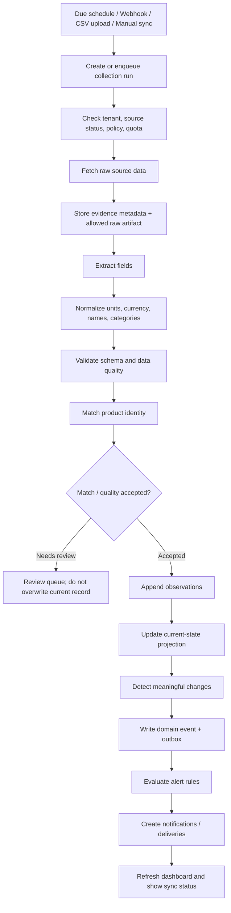
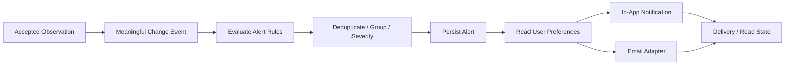
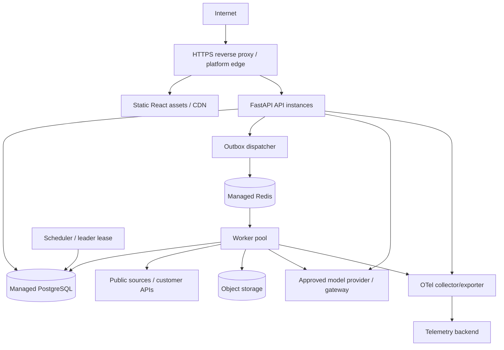

# MarketPulse AI — Product, System Design & Engineering Blueprint

**Document version:** 1.0  
**Status:** Foundational build specification  
**Prepared:** 19 November 2026  
**Product name:** MarketPulse AI  
**Tagline:** *Know the market. Anticipate the move.*  
**Demonstration retailer:** NexaTech (fictional electronics retailer)  
**Primary implementation goal:** A production-minded, category-independent, multi-tenant market-intelligence SaaS built as a complete end-to-end engineering project.

---

## How to use this document

This is the source-of-truth design for the MarketPulse AI implementation. The coding agent must read it before changing code. It defines product boundaries, architecture, domain concepts, data contracts, security controls, quality gates, user experience, deployment expectations, and the implementation sequence.

**Build rule:** Implement one verified vertical slice at a time. Do not attempt to generate the entire application in one pass. Each milestone must leave the repository runnable, migrated, tested, and documented. Do not silently change a decision in this document; record a proposed change in an Architecture Decision Record (ADR), explain the trade-off, and update the design before implementation.

**Important reliability statement:** No architecture can honestly guarantee zero bugs or zero data-collection failures. This design reduces the probability and impact of failures through explicit contracts, immutable evidence, idempotency, tenant isolation, retries, observability, automated tests, evaluations, and controlled rollout. The system must expose uncertainty and failures instead of hiding them.

### Authority and conflict rules

1. Security, privacy, source permissions, and tenant isolation are hard constraints.
2. This blueprint is the product and architecture baseline.
3. Approved ADRs may refine implementation details, but must not silently remove product requirements.
4. Existing tests, migrations, and working behavior must not be destroyed to satisfy an agent's preference for a rewrite.
5. When a source cannot be accessed or a value cannot be verified, represent the limitation. Never fabricate a substitute observation.

---

# 1. Executive product definition

## 1.1 What MarketPulse AI is

MarketPulse AI is a **persistent market-intelligence platform for retailers**. A business connects its own data through a website, CSV/Excel file, API, ecommerce connector, webhook, or another supported integration. It configures product categories and competitors. MarketPulse then maintains a historical, evidence-backed view of the business's catalogue and its external market.

It combines two intelligence layers:

- **Local market intelligence:** products, specifications, displayed prices, availability signals, promotions, competitor assortment, price movement, and changes within a configured local market.
- **Global intelligence:** relevant technology and product trends, public customer feedback, international product and industry developments, and broader demand signals.

A single central **Market Intelligence Agent** lets an owner ask business questions, request investigations, interpret analytical results, and generate reports. The agent is not the database, not the crawler, and not the authority for arithmetic. Deterministic services collect, validate, store, compare, score, and calculate. The agent coordinates those services and explains their evidence.

The product's promise is not “AI predicts the future.” Its promise is:

> Connect your business once. Keep a reliable record of what changes in your market. Understand which changes matter, why they matter, how confident the evidence is, and what decisions may be worth considering.

## 1.2 Core product principles

1. **Persistent, not ephemeral:** source observations and their history are stored in the database. A new chat does not erase business intelligence.
2. **Evidence before explanation:** every important claim links to a source, timestamp, observation, or calculation.
3. **Current state plus history:** the system shows today's best-known value and preserves previous observations.
4. **Category-independent core:** product categories and attributes are configuration-driven. Laptop and smartphone logic must not be hardcoded into the agent or core product model.
5. **Local/global separation:** foreign prices, international popularity, local displayed prices, internal stock, and actual sales must never be conflated.
6. **One central agent:** use specialist tools and deterministic services, not a swarm of separate agents.
7. **Least privilege:** the agent can only call approved, tenant-scoped tools. Website text is untrusted data, never executable instructions.
8. **Human control:** competitor monitoring, sensitive data connections, and consequential external actions require explicit owner approval.
9. **Graceful degradation:** LLM downtime must not stop data imports, collection, price-change detection, database updates, or deterministic alerts.
10. **No fabricated certainty:** distinguish verified observations, derived metrics, hypotheses, and unavailable information.
11. **Independent of NexaTech:** NexaTech is a demonstration customer/store, not a hard dependency or the identity of MarketPulse.
12. **Operational transparency:** show last checked time, last successful sync, data freshness, source health, failures, and confidence.

## 1.3 Target users and jobs to be done

| User | Main job | Expected MarketPulse value |
|---|---|---|
| Retail owner / director | Understand competitors, prices, category gaps, and market changes | Decision-ready dashboard, alerts, reports, opportunity evidence |
| Commercial / category manager | Track product ranges and compare like-for-like products | Catalogue normalization, product matching, category analytics |
| Pricing manager | Understand market price position and changes | Historical prices, comparables, alerts, price-position analysis |
| Research / marketing analyst | Investigate trends, customer complaints, and emerging products | Source-backed research, feedback themes, trend evidence |
| Workspace administrator | Connect and govern data sources and users | Integration center, permissions, source health, audit history |

## 1.4 Explicit non-goals for the first release

MarketPulse is not initially:

- An ecommerce storefront, POS, ERP, accounting, or inventory-management replacement.
- A system that knows a retailer's actual sales volume merely by reading public product pages.
- A dynamic-pricing engine that automatically changes prices.
- A purchasing/procurement agent that places orders.
- A general-purpose web crawler allowed to browse any URL without controls.
- A guaranteed sales-demand forecasting service.
- A multi-agent platform.
- A platform that bypasses login walls, CAPTCHAs, paywalls, anti-bot controls, or other access restrictions.
- A requirement that every customer use WooCommerce, Shopify, or any particular ecommerce platform.

These may be future products or integrations, but must not be implied in the first release.

---

# 2. Product benchmark and design lessons

This is a product-pattern benchmark, not a claim that MarketPulse already matches every competitor's data coverage, scale, or reliability.

| Reference product / category | Publicly documented strengths | Lesson MarketPulse should adopt | Opportunity for MarketPulse differentiation |
|---|---|---|---|
| **Prisync** — competitor price monitoring | URL- or channel-based competitor monitoring, price-position comparison, stock availability, reports, price history, alerts, and API options [R1] | Reliable product/competitor matching, change history, alerts, and exports are core product features, not add-ons | Connect the retailer's own data with local competitor intelligence, customer voice, global trends, opportunity evidence, and one AI analyst |
| **Price2Spy** — pricing intelligence | Product feeds and bulk import, quick matching, price monitoring, market analytics, historical reports, marketplace/ecommerce integrations, and price-change/stock alerts [R2] | Support structured product feeds, matching workflows, historical reports, and configurable alerting | Make data-source onboarding flexible for ordinary websites, CSV, APIs, and ecommerce platforms, not only product feeds |
| **Visualping** — website change monitoring | Scheduled monitoring, page/element change detection, before/after comparison, AI summaries, user-defined alert criteria, and monitor pause/settings [R3] | Show what changed, before/after evidence, why the alert fired, and how to pause or tune a monitor | Convert page changes into typed product/price/availability observations and downstream market analysis, not just generic page diffs |
| **Keepa** — marketplace product/price history | Historical product and price data, offers, deals, seller data, tracking, and update notifications through its API [R4] | Treat history and update notifications as durable product data | Cover broader customer-owned catalogues, non-Amazon competitors, category-independent data, and local market analysis |
| **Google Trends** — search interest signal | Relative, normalized, sampled search interest by geography and time; Google explains that it is not a perfect mirror of search activity and should not be treated as a scientific poll or direct proof of demand [R5] | Show methodology, geography, date range, sampling limitations, and interpret trends as one signal among several | Corroborate trend signals with local catalogue gaps, customer feedback, price context, and business fit |

## 2.1 MarketPulse product differentiation

The product should be designed around the connection between these evidence sources:

1. What the retailer sells or intends to sell.
2. What local competitors publicly offer and display.
3. How comparable prices and availability signals change over time.
4. What public customers repeatedly praise, complain about, or request.
5. Which technologies and products are gaining global attention.
6. Which opportunities fit the retailer's category, location, positioning, and declared business constraints.

The value is in **joining these sources without pretending they are the same thing**. A global search-interest increase does not prove local sales demand. A competitor page showing “in stock” does not prove their warehouse quantity. A public catalogue does not reveal the retailer's private sales or inventory system.

## 2.2 Benchmark-derived UX requirements

- Price screens must show current value, previous value, change amount/percentage, observation date, competitor, and evidence link.
- Change alerts must offer a clear “view evidence / before and after” path.
- Product matching must be visible and reviewable; uncertain matches must not be silently treated as exact.
- Monitoring jobs must be pausable, configurable, and show last successful check.
- Reports must be exportable and retain their source references.
- Trend screens must explain how the signal was measured and what it cannot establish.

---

# 3. Product scope and functional requirements

## 3.1 Release definition

The first deployable release should support one real customer workspace and a separate read-only demo workspace. It should support multiple product categories and multiple source types, but the initial validation corpus should remain small enough to inspect manually.

**Initial real-source target (not a guaranteed coverage claim):**
- One configured local market and currency for the first demonstration workspace.
- Two seeded categories: laptops and smartphones.
- One customer-owned data connection, initially CSV or a supported public catalogue website.
- One real competitor website/source proven end-to-end before adding more.
- Then expand toward approximately 3 approved competitor sources and 20–50 tracked listings when quality is stable.
- A small set of permitted feedback and global-trend sources, with source/date/sample-size metadata.

The NexaTech demo should use clearly labelled synthetic retailer data unless a real source is deliberately connected and its evidence is labelled as real. Demo data must never be presented as real market observations.

## 3.2 Functional requirements catalogue

### Accounts, workspaces, and access

- **FR-001:** Users can register, sign in, sign out, and recover access.
- **FR-002:** A user can belong to one or more organizations/workspaces through explicit membership.
- **FR-003:** Roles include `owner`, `admin`, `analyst`, and `viewer` with server-enforced permissions.
- **FR-004:** Every customer-owned record is tenant-scoped. No tenant may read or mutate another tenant's information.
- **FR-005:** Demo workspace access is clearly labelled, read-only, isolated, and resettable.

### Customer data connections

- **FR-010:** An owner can add a public website URL, CSV/XLSX file, custom API, webhook, or available ecommerce connector.
- **FR-011:** A connection setup flow inspects capabilities and reports what can and cannot be imported before activation.
- **FR-012:** A source can be configured as customer-owned/internal data or external/competitor intelligence. These types must not be mixed.
- **FR-013:** CSV imports include a column-mapping preview, validation report, row-level errors, and explicit confirmation before committing.
- **FR-014:** API/webhook credentials are stored server-side in encrypted form and never exposed back to browser code.
- **FR-015:** The owner can pause, resume, reauthorize, inspect, and disconnect a source.
- **FR-016:** Source health, last attempted sync, last successful sync, and error details are visible.

### Category and product catalogue

- **FR-020:** Products use a shared category-neutral core model: identity, brand, model, name, URL, price/currency, availability signal, source, and timestamps.
- **FR-021:** Category-specific attributes are schema-driven, not hardcoded into the universal product table or agent prompt.
- **FR-022:** New ordinary categories can be added through category definitions, attribute schemas, units, aliases, and comparison profiles.
- **FR-023:** The system supports product variants and bundles where sources provide them.
- **FR-024:** Product matching produces confidence and match rationale; uncertain matches require review.
- **FR-025:** A product's current projection can be updated without deleting its append-only observation history.

### Competitor intelligence

- **FR-030:** Owner can add a competitor manually with name, URL, market, and optional notes.
- **FR-031:** Owner can request competitor discovery by question or use an opt-in recurring discovery schedule.
- **FR-032:** Discovered businesses move through candidate, verified, reviewed, approved, monitored, paused, and rejected states.
- **FR-033:** Competitor records are separate from product categories. One competitor may cover multiple categories.
- **FR-034:** Competitor-category coverage is independently assessed and recorded.
- **FR-035:** Monitoring begins only after explicit approval.
- **FR-036:** The system distinguishes direct, adjacent, potential, and irrelevant competitors.

### Ongoing synchronization and history

- **FR-040:** Website sources are checked only according to configured schedules and source policy.
- **FR-041:** CSV/API/ecommerce changes enter through imports, polling, webhooks, or manual updates.
- **FR-042:** All normalized observations record `observed_at`, `collected_at`, source, method, and quality status.
- **FR-043:** Price, availability, product, promotion, and category changes are detected deterministically.
- **FR-044:** The system stores history and current state; it must not overwrite the only copy of an earlier value.
- **FR-045:** Partial or failed extraction must not be treated as product deletion or a confirmed “out of stock” value.
- **FR-046:** Duplicate events, repeated imports, retries, and webhook redelivery must be idempotent.

### Global trends and customer voice

- **FR-050:** Trends include source, geography, period, method, sample size (when available), and limitations.
- **FR-051:** Customer feedback is collected only from sources and methods that are permitted; source URL, date, and sample count are preserved.
- **FR-052:** Feedback theme/sentiment extraction is a derived interpretation and must link to the underlying items or aggregate sample.
- **FR-053:** Trend and feedback screens distinguish observed evidence from inferred themes.

### Opportunity intelligence

- **FR-060:** Opportunity scoring is calculated by deterministic, versioned Python logic.
- **FR-061:** Score factors and weights are visible and configurable.
- **FR-062:** Evidence confidence is separate from opportunity score.
- **FR-063:** Missing evidence lowers confidence and cannot be silently replaced with fabricated values.
- **FR-064:** Each opportunity includes explanation, evidence, assumptions, limitations, recommended next validation step, and calculation version.

### AI Analyst and memory

- **FR-070:** A single central Market Intelligence Agent answers questions by calling authorized, typed tools.
- **FR-071:** The agent retrieves current information and evidence from the tenant-scoped database; it does not rely on chat context as the source of truth.
- **FR-072:** The agent can summarize a conversation and store explicit, editable workspace memory when appropriate.
- **FR-073:** Agent answers cite internal evidence identifiers and source links, plus observation timestamps.
- **FR-074:** The agent abstains or asks a clarifying question when the required evidence is missing or ambiguous.
- **FR-075:** Agent runs record provider, model, prompt version, tool calls, token/cost metadata when available, latency, and result status.
- **FR-076:** LLM provider can be changed through configuration/adapters without rewriting domain services or tools.

### Notifications and reports

- **FR-080:** A notification center displays significant changes, source failures, new discoveries, and opportunity signals.
- **FR-081:** Alerts have severity, rule, evidence, deduplication key, creation time, and read/acknowledged state.
- **FR-082:** Users can tune alert thresholds, channels, quiet hours, and notification preferences.
- **FR-083:** Initial channel is in-app notification; email is an adapter that can be configured independently.
- **FR-084:** Delivery attempts, retries, and failures are recorded.
- **FR-085:** Reports can be generated in a web view and exported to CSV/PDF later; the report preserves source references and generation time.

## 3.3 Non-functional requirements

| Area | Requirement |
|---|---|
| Reliability | Background jobs survive API restarts; retries are bounded; failed work is inspectable and replayable where safe |
| Consistency | Database transactions protect observation, current-state projection, change event, and outbox writes |
| Idempotency | Import, webhook, job, change-event, alert, and notification processing has explicit idempotency keys |
| Security | AuthN/AuthZ, tenant isolation, encrypted secrets, secure cookies/CSRF controls, outbound URL controls, audit trails |
| Explainability | Business claims link to source evidence and calculation versions |
| Extensibility | New categories and ordinary integrations should not require changes to the central agent |
| Portability | Dockerized API/worker; PostgreSQL-backed; provider-independent LLM interface |
| Performance | Paginated tables; background collection; bounded LLM context; query indexes based on real query plans |
| Accessibility | Keyboard support, semantic HTML, readable contrast, clear statuses, responsive layouts |
| Maintainability | Modular monolith, typed boundaries, migrations, clean dependency direction, CI gates |
| Cost control | Usage limits, collection quotas, model budgets, cache/reuse, no mandatory paid LLM at runtime |
| Privacy | Tenant isolation, data minimization, retention/deletion rules, no secrets or unnecessary personal data in logs/prompts |

---

# 4. Core domain model and language

The following terms must have consistent meaning throughout code, APIs, database names, and UI copy.

| Concept | Meaning |
|---|---|
| Organization / tenant | A customer business account whose data must be isolated from every other customer |
| Workspace | A working context under an organization; the first release may use one primary workspace per organization while retaining the separation in the model |
| Customer source | A source the retailer owns or is authorized to connect, such as its catalogue, website, CSV, API, or ecommerce platform |
| Competitor | An external business that may compete in one or more product categories |
| Source endpoint | A particular URL, API endpoint, file feed, or integration endpoint that can be collected from |
| Collection run | One attempt to retrieve and process data from a source |
| Evidence item | Immutable or versioned source material supporting a specific observation or claim |
| Observation | A time-stamped normalized fact as reported by a source at a particular time |
| Current projection | The latest accepted value derived from observations; it is replaceable, but history is not |
| Product identity | A normalized record representing a product/model/variant, distinct from a page listing |
| Product listing | A source-specific representation of a product on a retailer/competitor source |
| Product match | A relationship between two listings/products, with status, confidence, and rationale |
| Signal | A measured or extracted datum, such as search interest, feedback theme, or product launch mention |
| Opportunity | A candidate business action supported by multiple evidence classes and a transparent score |
| Confidence | The quality/completeness/recency/corroboration of the evidence; not the same as the opportunity score |
| Alert rule | A user-defined or built-in condition that can create an alert |
| Notification | A delivery-oriented representation of an alert for a user/channel |
| Agent run | One bounded AI Analyst execution with a trace, tool calls, limits, and final answer |
| Workflow | A durable multi-step background process with state and recovery behavior |

## 4.1 Product and category neutrality

The universal product model should have fields that make sense for almost any retail product:

- Stable internal product ID.
- Category ID.
- Brand, manufacturer, canonical model, display name.
- SKU/MPN/GTIN/UPC/EAN where available (optional, not required).
- Product family and variant relationships.
- Canonical URL and images metadata where allowed.
- Generic attributes JSON object validated against the category schema.
- Lifecycle status and timestamps.

Examples of category-specific attribute schemas:

**Laptop:** processor family, processor model, RAM, storage capacity/type, display size, resolution, GPU, battery capacity, weight, operating system.

**Smartphone:** chipset, RAM, storage, screen size/type, resolution, refresh rate, camera configuration, battery capacity, charging, operating system.

**Monitor:** panel type, diagonal size, resolution, refresh rate, response time, ports, HDR support.

**Camera:** sensor format, resolution, lens mount, autofocus, video modes, stabilization.

A category definition contains:

- Stable slug and display name.
- JSON Schema (or equivalent versioned schema) for category attributes.
- Attribute labels, data types, units, aliases, allowed values, and normalization rules.
- Comparison profile (which attributes are important, exact-match rules, tolerances, and weights).
- Optional source extraction hints or adapter references.
- Schema version and migration strategy.

**Extensibility boundary:** a new category should usually be added through data/configuration. A new website layout, novel attribute extraction method, or specialized domain comparison may still require a new connector or extractor implementation. Do not promise that every arbitrary category and website works without engineering.

## 4.2 Competitor classification

- **Candidate:** discovered but not yet sufficiently verified.
- **Verified business:** business identity and website are reasonably supported by evidence.
- **Relevant category:** evidence suggests actual products/listings in the configured category.
- **Direct competitor:** meaningful comparable products in the same category/market.
- **Adjacent competitor:** related but only partial overlap.
- **Potential competitor:** insufficient evidence to make a stronger classification.
- **Irrelevant:** no meaningful category/market overlap.
- **Approved:** owner approved this source for monitoring.
- **Monitored:** an active schedule exists and collection is permitted/configured.
- **Paused / rejected:** no collection is currently performed.

A business is not a competitor merely because it appeared in search results. Discovery candidates must pass verification and owner approval before continuous collection.

---

# 5. System architecture

## 5.1 Architectural style

Use a **modular monolith with separately deployed API and worker processes**, not microservices.

Why:
- One developer and a small project team can reason about one codebase and shared domain model.
- Clear module boundaries provide maintainability without distributed transaction complexity.
- The API and background workers can scale independently when needed.
- Stable internal interfaces make later service extraction possible if evidence justifies it.

The API and worker are distinct runtime processes but share domain/application modules and the same PostgreSQL system of record. Browser collection runs in a worker/isolated browser execution environment, never inside a latency-sensitive request handler.

## 5.2 High-level component diagram

```mermaid
flowchart TB
    U[Retail Owner / Analyst] --> WEB[React + TypeScript Web App]
    WEB --> API[FastAPI Application]
    API --> AUTH[Auth + Tenant Context]
    API --> APP[Application Services]
    APP --> DB[(PostgreSQL System of Record)]
    APP --> OUTBOX[Transactional Outbox]
    OUTBOX --> DISPATCH[Outbox Dispatcher]
    DISPATCH --> Q[(Redis / Dramatiq Broker)]
    Q --> WORKER[Worker Processes]
    WORKER --> CONNECT[Integration & Collection Adapters]
    CONNECT --> SITES[Approved Public Websites / Customer APIs / Files]
    WORKER --> ANALYTICS[Deterministic Analytics Services]
    ANALYTICS --> DB
    WORKER --> ALERTS[Alert & Notification Services]
    ALERTS --> DB
    ALERTS --> CHANNELS[In-App / Email Adapters]
    API --> AGENT[Market Intelligence Agent]
    AGENT --> TOOLS[Typed Tool Gateway]
    TOOLS --> APP
    AGENT --> LLM[LLM Provider Adapter / Router]
    LLM --> PROVIDERS[Configured Model Provider(s)]
    API --> OTEL[OpenTelemetry Instrumentation]
    WORKER --> OTEL
    AGENT --> OTEL
    OTEL --> OBS[Telemetry Backend / Phoenix / Metrics]
    WORKER --> OBJECTS[(Object Storage Adapter)]
    CONNECT --> OBJECTS
```

## 5.3 Runtime components

| Component | Owns | Must not own |
|---|---|---|
| Web frontend | User experience, dashboards, forms, charts, interaction state | Credentials, authorization decisions, direct database access, scraping |
| FastAPI API | Authentication, tenant context, request validation, API contracts, application-service calls | Long browser jobs, heavy scraping, long-running LLM jobs |
| Domain/application layer | Business rules, use cases, policy checks, transaction boundaries | HTTP-specific or React-specific logic |
| Worker | Imports, collection, analysis, discovery, scheduled jobs, notifications, reports | Unrestricted browser access or user-facing auth decisions without a tenant context |
| PostgreSQL | Durable business records, workflow state, source history, configuration, audit, memory | Large unbounded HTML/screenshot blobs |
| Redis + Dramatiq | Job transport and worker dispatch | Canonical business state or permanent history |
| Integration adapters | Source-specific authentication, fetching, extraction, webhook normalization | Directly changing product state without validation and domain-service approval |
| Analytics services | Deterministic matching, comparisons, scoring, change detection | Inventing missing input data or relying on LLM arithmetic |
| AI Agent | Query understanding, tool selection, interpretation, explanation, report composition | Direct SQL, bypassing tenant checks, arbitrary HTTP fetch, direct price/inventory mutation |
| Observability stack | Traces, logs, metrics, evaluations | Storing secrets or raw customer content by default |

## 5.4 Backend module boundaries

Use dependency direction:

`API / Worker entrypoints -> Application use cases -> Domain model + Ports -> Infrastructure adapters`

Domain and application code must not import FastAPI, Playwright, vendor SDKs, or React.

Recommended backend package:

```text
backend/
  pyproject.toml
  alembic.ini
  migrations/
  src/marketpulse/
    main.py                    # FastAPI app factory / lifespan
    config.py                  # typed settings and validation
    core/
      errors.py                # stable application errors
      ids.py
      clock.py
      security.py
      tenancy.py
      pagination.py
      logging.py
      telemetry.py
    domain/
      organizations/
      catalog/
      categories/
      sources/
      competitors/
      observations/
      matching/
      analytics/
      opportunities/
      alerts/
      notifications/
      conversations/
      memory/
      workflows/
    application/
      commands/
      queries/
      services/
      ports/                   # interfaces/protocols
    infrastructure/
      db/                      # SQLAlchemy models, repositories, UoW
      queue/                   # Dramatiq broker, task definitions, outbox dispatcher
      storage/                 # local/S3-compatible blob adapter
      llm/                     # provider/model adapters
      search/                  # competitor discovery/search providers
      email/
      telemetry/
    integrations/
      customer_web/
      competitor_web/
      csv_import/
      generic_rest/
      webhooks/
      ecommerce/
        woocommerce/           # later connector
        shopify/               # later connector
    collectors/
      http/
      browser/
      parsing/
      extraction/
      normalization/
      policy/
    agent/
      analyst.py
      instructions/
      tools/
      schemas/
      memory_policy.py
    workflows/
      source_onboarding.py
      source_sync.py
      competitor_discovery.py
      competitor_monitoring.py
      opportunity_refresh.py
      notification_delivery.py
    api/
      deps.py
      error_handlers.py
      v1/
        routers/
        schemas/
    worker/
      app.py
      tasks/
  tests/
    unit/
    integration/
    contract/
    security/
    e2e/
  evals/
    datasets/
    evaluators/
    scenarios/
```

The exact file names can be refined during implementation, but the module boundaries and dependency direction are mandatory. Avoid a huge `services.py`, `utils.py`, or single-file application.

## 5.5 Frontend module boundaries

```text
frontend/
  src/
    app/                       # router, providers, app shell
    components/
      ui/                      # reusable primitives
      layout/
      data-display/
      feedback/
    features/
      overview/
      competitors/
      pricing/
      trends/
      customer-voice/
      opportunities/
      analyst/
      notifications/
      integrations/
      monitoring/
      settings/
      auth/
    hooks/
    lib/                       # API client, schemas, formatting, auth helpers
    styles/
    types/
  tests/
```

Each feature owns its pages, reusable feature components, query/mutation hooks, schemas, and tests. Do not place business logic in giant page components. Server state belongs in TanStack Query; local UI state should remain local or use a small store only when shared across routes.

---

# 6. Technology decisions

Use the versions supported by the chosen deployment platform at implementation time. Pin dependencies in lockfiles and upgrade deliberately; do not copy version numbers from stale examples.

| Layer | Baseline decision | Reason / boundary |
|---|---|---|
| Frontend | React + TypeScript + Vite | Mature component ecosystem, typed UI, lightweight build pipeline |
| UI styling | Tailwind CSS + accessible component primitives (shadcn/ui or equivalent) | Consistent visual system without inventing every primitive |
| Routing | React Router | Explicit page and nested-layout structure |
| Server state | TanStack Query | Query cache, mutations, invalidation, request state |
| Forms/schema | React Hook Form + Zod | Typed form validation; server still validates independently |
| Charts | Recharts or another actively maintained accessible chart library | Price history, trends, comparison charts |
| API | FastAPI + Pydantic v2 | Typed validation, OpenAPI, async request handling |
| Python runtime | Python 3.12+ where dependencies support it | Use a supported current interpreter; pin exact version in CI and Docker |
| ORM / DB | SQLAlchemy 2.x + PostgreSQL | Explicit transaction/repository boundaries and mature relational persistence |
| Migrations | Alembic | Versioned database evolution; review generated migrations manually |
| Database | PostgreSQL (primary and required for production) | Transactions, constraints, JSONB category attributes, RLS, indexes |
| Job processing | Dramatiq + Redis broker | Separate worker process, bounded retries, delayed jobs, dead-letter handling |
| Scheduling | Database-backed schedule records + a scheduler process | One source of schedule truth, easy to inspect and recover |
| Browser collection | Playwright (Python) only when static HTTP parsing is insufficient | Controlled browser rendering; not an unrestricted general crawler |
| Static HTML parsing | HTTPX + selectolax/BeautifulSoup | Prefer lighter fetch/parse path before opening a browser |
| LLM agent | PydanticAI with typed tools/output and a provider adapter | Single central agent, structured boundaries, provider options |
| LLM gateway | Optional LiteLLM or compatible model gateway later | Add when central keys, budgets, routing, or many providers justify another service |
| Telemetry | OpenTelemetry + structured JSON logs | Vendor-neutral traces/metrics and consistent context propagation |
| Agent trace/eval UI | Arize Phoenix as the initial self-hostable development/evaluation tool | Traces, evaluation, datasets, experiments; do not run Phoenix and Langfuse together initially |
| Tests | pytest, pytest-asyncio, HTTPX TestClient, Playwright Test/e2e | Unit, integration, API contract, and browser tests |
| Python quality | Ruff, mypy or Pyright, pre-commit | Formatting, linting, and static checks |
| Frontend quality | ESLint, TypeScript strict mode, Vitest, Playwright | Type safety and user journey regression checks |
| Packaging / deployment | Docker + Docker Compose + GitHub Actions | Repeatable local and production build; CI quality gates |

### Queue decision and risk

Dramatiq uses Redis or RabbitMQ as a message broker and supports retry middleware and dead-letter behavior [R6]. Redis is **not** the system of record. PostgreSQL stores collection runs, workflow steps, source observations, outbox events, and delivery outcomes. The outbox dispatcher publishes jobs to Redis. If a broker message is delivered twice, the job handler must safely detect that the associated work has already been completed.

Do not use FastAPI `BackgroundTasks` for browser crawls, imports, scheduled polling, or other long-running jobs. FastAPI documents those tasks as suitable for small background work and points to a separate worker/queue system for heavier work [R7].

A later, more complex deployment may evaluate Temporal for durable long-running workflows and human wait states; Temporal documents workflow resumption across failures and human approvals [R8]. Do not add Temporal to the first build unless real workflow requirements outgrow the current job/workflow model.

### Agent framework decision

Use **one PydanticAI-based Market Intelligence Agent**. PydanticAI supports many provider families and model fallbacks, but actual feature support varies by provider/model/API [R9]. Hide the framework behind an internal `AnalystAgent` application interface so the rest of the system does not depend on PydanticAI-specific types.

Do not use LangGraph and PydanticAI simultaneously in the first release. LangGraph's checkpoint/store distinction and interrupt mechanism are legitimate options for stateful graph execution [R10], but MarketPulse's first workflows are deterministic business workflows and should be persisted by the application, not by a conversational graph runtime.

### Database decision

Use PostgreSQL from the first real vertical slice. SQLite can be used for isolated unit tests only when behavior is equivalent; it is not the target integration/production database. This avoids discovering late that production depends on JSONB, RLS, locking, `SKIP LOCKED`, or PostgreSQL-specific migrations.

---

# 7. Data architecture and permanent memory

## 7.1 The system's permanent memory

The AI agent does not “permanently remember everything” inside its prompt or model. **PostgreSQL is the durable system of record.** The agent queries the database through application services and receives only the tenant-scoped information needed for the current task.

MarketPulse uses five memory/data layers:

1. **Business system-of-record memory:** products, categories, integrations, competitors, observations, history, analytics, opportunities, alerts, user settings.
2. **Evidence memory:** source URLs, capture times, source metadata, file checksums, selected page extracts, before/after diffs, and provenance.
3. **Workflow memory:** durable run states, attempts, approvals, checkpoints, errors, and recovery metadata.
4. **Conversation memory:** recent conversation messages and compact conversation summaries tied to a workspace/thread.
5. **Explicit workspace memory:** owner-approved facts/preferences such as the retailer's target market, preferred currency, strategic positioning, excluded brands, margin thresholds if supplied, and reporting preferences. These must be visible/editable/deletable.

Vector search may be added later for semantic discovery over permitted evidence. It must not replace relational records, source citations, or exact product/price queries. pgvector is optional, not a first-release dependency.

## 7.2 Observation model: append-only facts + current projections

Every collection produces normalized observations. Do not update an observation in place to represent a new point in time.

For example:

| observed_at | source | product | price | currency | status |
|---|---|---|---:|---|---|
| 2026-11-17 08:00 UTC | NexaTech catalogue | NexaBook Pro 15 | 1200 | USD | accepted |
| 2026-11-18 08:00 UTC | NexaTech catalogue | NexaBook Pro 15 | 1100 | USD | accepted |

A current product/listing projection points to the latest accepted observation. Historical rows remain available for price charts, alerts, and audit.

**Never infer deletion from absence in a partial scrape.** A product can only be marked missing/removed after a sufficiently complete, validated catalogue crawl or explicit authorized source signal. “Unavailable”, “not found”, “not checked”, “not offered”, and “out of stock” are separate states.

## 7.3 Source and provenance model

Each observation should be traceable to:

- Organization/workspace ID.
- Source ID and source type.
- Source URL or imported file reference.
- Collection run and run item.
- `observed_at` (when the source says the fact applies, if known).
- `collected_at` (when MarketPulse retrieved it).
- Capture method (API, webhook, browser, static HTTP, CSV, manual).
- Parser/extractor version.
- Evidence ID and content hash.
- Validation status, quality flags, and confidence metadata.

Do not log or show private API keys, session tokens, or personally identifying information from source payloads. Store only what the product needs.

## 7.4 Initial relational entities

The final SQLAlchemy model and migrations must cover at least these logical entities. The coding agent may split tables further but must preserve the semantics.

| Entity / table group | Key purpose and important fields |
|---|---|
| `users` | Identity, email, password hash / auth provider subject, status, timestamps |
| `organizations` | Tenant identity, display name, default market, timezone, base currency |
| `workspaces` | Workspace context, organization ID, demo/read-only flags |
| `memberships` | User-to-organization/workspace roles and invitation state |
| `category_definitions` | Slug, schema JSON, schema version, attribute metadata, comparison profile |
| `products` | Canonical product identity, category, brand, model, normalized identity key |
| `product_variants` | Variant relationships and identifiers |
| `product_attribute_values` or category JSONB | Category-specific values with schema version; choose a consistent strategy and index common filters |
| `product_listings` | Source-specific listing URL/title/product association and listing status |
| `sources` | Source owner/type, source URL, connector type, market, policy, schedule, status |
| `source_credentials` | Encrypted secrets or secure secret references; never plaintext |
| `source_capabilities` | Verified abilities: catalogue, price, availability, API, webhook, pagination, etc. |
| `collection_runs` | Start/end, status, source, attempt, records seen/accepted/rejected, error classification |
| `collection_run_items` | Page/product-level outcomes, retries, validation notes |
| `evidence_items` | URI, metadata, checksum, capture time, storage reference, evidence kind |
| `product_observations` | Append-only normalized product facts/specifications and provenance |
| `price_observations` | Append-only monetary observations, currency, tax/shipping semantics when known |
| `availability_observations` | Append-only availability state and evidence |
| `promotion_observations` | Discount/promotion detail, source dates, conditions when known |
| `competitors` | Business identity and canonical website |
| `competitor_category_coverage` | Competitor/category status, evidence, confidence, verification date |
| `competitor_product_listings` | Competitor listing to canonical product mapping |
| `product_matches` | Listing/product pair, match type, score, rationale, reviewer, status |
| `trend_signals` | Topic/product/technology, geography, period, source, value/unit, methodology, limitations |
| `feedback_items` | Permitted review/discussion evidence, source, dates, sanitized text, product/category association |
| `feedback_themes` | Derived theme, sentiment/stance, sample size, method/model version, evidence links |
| `opportunities` | Candidate, score, confidence, status, score version, owner notes |
| `opportunity_evidence` | Explicit links between opportunity and supporting/contradicting evidence |
| `alert_rules` | Owner-defined thresholds and built-in rule configuration |
| `alerts` | Alert type/severity, tenant, entity, dedupe key, evidence, status |
| `notifications` | Per-user delivery intent, channel, status, retry, sent/failed timestamps |
| `notification_preferences` | Channel enablement, thresholds, quiet hours, categories |
| `integrations` | Connector configuration/status and authorization scope |
| `webhook_events` | Provider event ID, signature result, received time, idempotency status |
| `workflow_runs` / `workflow_steps` | Durable progress, state, attempt, outputs references, approval waits |
| `scheduled_jobs` | Source/run schedule, next due time, schedule state, lease/owner |
| `outbox_events` | Transactionally committed business events awaiting publication |
| `audit_events` | Actor, action, entity, timestamp, request/trace ID, safe metadata |
| `conversations` / `messages` | Tenant-scoped AI conversations and message history |
| `workspace_memories` | Explicit structured memory with source, owner, created/updated and deletion controls |
| `agent_runs` / `tool_invocations` | Agent execution, model, prompt version, tool name/args hash, result status, latency |
| `llm_usage_records` | Provider/model, request type, token usage, cost when known, limits, outcome |
| `prompt_versions` | Versioned system/tool instructions, hash, status, effective date |
| `evaluation_runs` | Dataset/version, model/config, evaluator results, run metadata |

## 7.5 Critical indexes and constraints

At minimum:

- All tenant-scoped tables include `organization_id` (and `workspace_id` where needed) with indexes for common tenant/entity/time queries.
- Unique constraints for tenant-scoped external IDs and canonical product identity where applicable.
- Unique webhook event key `(source_id, provider_event_id)` where the provider guarantees event IDs.
- Unique idempotency keys for import batches, source sync jobs, alert generation, and notification attempts.
- Index `(source_id, collected_at DESC)` for source history.
- Index `(product_id, observed_at DESC)` for time series.
- Index `(organization_id, created_at DESC)` for alert and activity lists.
- Index competitor/category status and product-match status for review queues.
- Use partial indexes for active schedules and undelivered outbox events when justified by query plans.
- Use numeric/decimal types for money; never binary floating point for price arithmetic.

Partition large append-only observation tables by time only when volume justifies operational cost. Do not prematurely partition the small MVP database.

## 7.6 PostgreSQL tenant isolation

Use two defenses:

1. Application layer requires a validated tenant context for every repository operation.
2. PostgreSQL Row-Level Security policies provide defense in depth for tenant-scoped tables. PostgreSQL documents RLS policies as restrictions on which rows can be selected or modified; when enabled without a matching policy, access is default-deny [R11].

Important implementation details:
- Set tenant identity with transaction-local session variables after authentication; never trust a client-supplied organization ID alone.
- Application DB role must not own the tables or have `BYPASSRLS` privileges.
- Ensure worker jobs have explicit tenant context and use the same repository/RLS paths.
- Add automated cross-tenant negative tests for every major repository and API group.
- Demo seed data belongs to a separate demo organization/workspace and never shares private production rows.

## 7.7 Money, geography, currency, and timestamps

- Store monetary amount as `NUMERIC`, currency as ISO 4217 code, and original display text as evidence metadata when useful.
- Do not compare different currencies without an explicit FX source, rate, and timestamp. Display converted values as estimates, not source prices.
- Store UTC timestamps (`TIMESTAMPTZ`) and retain the configured market timezone for schedules/display.
- Record source locale/market, tax inclusion, shipping inclusion, and unit basis when known. Unknown tax/shipping status must remain unknown.
- A price “change” comparison must use a comparable basis. A price with a different currency or variant is not a direct like-for-like change.

## 7.8 Storage for raw evidence

Do not put large HTML pages, screenshots, files, or full browser traces directly into ordinary relational rows. Create an `EvidenceStorage` port:
- Local filesystem adapter for development.
- S3-compatible object storage adapter for deployment.
- Postgres retains metadata, checksum, tenant ownership, capture time, and storage key.

Keep retention limits and source permissions explicit. Store only source material required for audit/reproduction; prefer minimal excerpts over indiscriminate full-site archiving.

---

# 8. Integrations and data ingestion

## 8.1 Customer connection strategy

MarketPulse must be platform-independent. A customer does not need an ecommerce checkout system to benefit from public catalogue monitoring and product intelligence.

Support these connection classes:

| Class | Examples | Possible data | Important limitation |
|---|---|---|---|
| Public business/catalogue website | Ordinary company website, catalogue page, product detail page | Public product name, specifications, displayed price when visible, public availability text | Does not reveal private stock, sales, margins, customer orders, or private CRM records |
| Product catalogue website | Public catalogue with or without checkout | Product listings, attributes, displayed price, selected availability signals | Dynamic layouts and incomplete pages can limit extraction |
| Ecommerce platform | WooCommerce, Shopify, others through adapters | Authorized catalogue data; possibly inventory/prices depending on granted scope | Must use least-privilege API scopes and secure credentials |
| Generic API | Customer REST/JSON API | Whatever data the API contract and credential scope expose | Needs mapping/schema and endpoint verification |
| CSV / Excel | Product feed, inventory export, price list | Columns explicitly supplied by owner | Updates only when file is re-uploaded or source is configured for scheduled import |
| Webhook | Ecommerce, ERP, custom application events | Event-driven product/price/inventory changes | Must validate signature, deduplicate, and reconcile with API/source |
| Manual entry | Business facts, products, competitor URLs | User-supplied fields | Must label as manually supplied and record editor/time |

## 8.2 Source capability inspection

When an owner enters a website, MarketPulse runs a bounded discovery/preview workflow:

1. Validate the URL scheme, hostname, DNS resolution, redirects, and destination IP safety.
2. Fetch the homepage and a small number of likely public catalogue/product pages under a strict page/time/size budget.
3. Check public access policy and robots instructions; robots rules are not authorization, as RFC 9309 explicitly notes [R12]. Terms, contractual permissions, privacy obligations, and access controls still matter.
4. Detect likely site platform and public navigation/catalogue structure where possible.
5. Identify fields that appear available: name, brand, model, price, currency, specs, product URL, availability text, pagination, product categories.
6. Produce a source capability report: `verified`, `not_verified`, `unsupported`, or `unknown` for each capability.
7. Show sample extracted records and validation warnings to the owner.
8. Require owner approval before activating recurring synchronization.

Do not claim “integration complete” merely because the homepage loads. A site may have no public product catalogue, no consistent product identity, no displayed prices, or may block automated access.

## 8.3 Connector interface

Every connector must implement a shared internal contract conceptually similar to:

```python
class SourceConnector(Protocol):
    async def inspect(self, request: InspectRequest) -> SourceCapabilityReport: ...
    async def fetch(self, request: FetchRequest) -> AsyncIterator[RawRecord]: ...
    async def normalize(self, record: RawRecord, schema: CategorySchema) -> NormalizedRecord: ...
    async def health_check(self, source: SourceConfig) -> SourceHealth: ...
```

Connector output must be raw/normalized data plus provenance. A connector must not bypass the central validation, product-matching, observation persistence, alert, or audit services.

## 8.4 CSV/Excel import requirements

- Support documented CSV initially; add `.xlsx` when the CSV path is stable.
- File size, row count, file type, encoding, formula, and decompression limits must be enforced.
- Never execute spreadsheet formulas or macros.
- Preview column mapping and normalized sample rows before commit.
- Validate each row independently and report accepted/rejected reasons.
- Preserve original upload checksum and import batch ID.
- Idempotency: same file/checksum + mapping + source should not create duplicate observations unless an explicit re-import mode is selected.
- A changed file creates a new import batch and new observations.
- CSV is not automatically monitored on the owner's local computer. It changes only when a new file is uploaded or the customer makes the file available to a configured secure polling mechanism.

## 8.5 Website collection policy and safety

Website access is the highest-risk integration surface. Implement:

- Allow only `http` and `https`; reject `file`, `ftp`, `gopher`, and other schemes.
- Block localhost, private IPv4/IPv6, link-local, loopback, multicast, reserved, and cloud metadata destinations.
- Resolve DNS and validate every resolved address before connection; repeat checks after redirects and before each new navigation to reduce DNS-rebinding/SSRF risk.
- Restrict redirect count and destination host changes.
- Enforce domain allowlists, page count, max response bytes, navigation timeout, concurrency, and per-domain request interval.
- Use a unique non-persistent browser context per collection job where possible; do not reuse customer cookies across tenants. Playwright browser contexts provide independent browser sessions and non-persistent contexts do not write browsing data to disk [R13].
- Prefer HTTP fetch + static HTML parser; launch Playwright only when JavaScript-rendered content is needed.
- Do not solve CAPTCHAs, evade bot protection, impersonate logged-in users without authorization, rotate proxies to bypass blocks, or continue after an explicit denial.
- Respect published site policies, applicable terms and law; pause and report when access is blocked or permission is uncertain.
- Never execute page scripts provided by a site beyond the browser's normal rendering environment, and never interpret page content as agent instructions.
- Browser process runs in an isolated container/worker with restricted network egress and no production secrets mounted unnecessarily.

The robots exclusion protocol is a crawler coordination standard, not a grant of permission [R12]. The product must not treat an empty or permissive robots file as legal authorization.

## 8.6 Competitor discovery

Discovery has three entry paths:

1. **Initial guided discovery:** after onboarding, owner provides market/location, business type, and target product categories. A configured `SearchProvider` returns candidates; connectors verify public website, business identity, and category listings. Owner reviews and approves.
2. **Question-driven discovery:** owner asks, for example, “Find more smartphone retailers in Addis Ababa.” The agent creates a discovery request using the same deterministic discovery workflow. It returns candidates, not automatically monitored competitors.
3. **Scheduled discovery:** owner enables recurring candidate discovery for selected categories/markets. New candidates are presented in an approval queue.

The `SearchProvider` is pluggable. Search API coverage and free quotas change. The core product must work when no search provider is configured: manual competitor URLs and user-supplied business names remain available. Do not make a paid search API a hard requirement for local development.

Discovery workflow states:

`requested -> searching -> candidates_found -> verifying -> owner_review -> approved/rejected -> monitoring_configured`

Every candidate includes business name, canonical website if verified, market/category relevance, supporting evidence, discovery timestamp, verification status, and unresolved questions.

## 8.7 Competitor data is separate from customer data

The customer connection represents the retailer's own authorized data. Competitor sources represent external public/approved observations. Never blend these silently.

A retailer can sell laptops and smartphones while each competitor can have coverage in either or both. Store the competitor once; configure category coverage separately. If a later customer starts monitoring smartphones, reuse the competitor record and add the smartphone coverage check.

## 8.8 NexaTech integration strategy

NexaTech is a separate fictional electronics retailer, initially selling laptops and smartphones.

- Build and operate it as an independent store/site (WordPress + WooCommerce is the pragmatic demonstration option).
- Do not build NexaTech before the MarketPulse source/connector contracts and data model are stable.
- Start integration with read-only catalogue/price access.
- Use signed webhooks if available, then fetch/verify the affected product through the authorized API before accepting the observation.
- Never expose WooCommerce/API secrets to React/browser code.
- A store update should result in: verified webhook -> idempotent event -> source reconciliation -> observation persisted -> current projection updated -> alert evaluated -> dashboard refreshed.
- Synthetic NexaTech data must carry `is_demo_data=true` or an equivalent origin label and be visually marked as illustrative.

---

# 9. Synchronization, workflows, and change detection

## 9.1 Durable background work

All long-running operations become persisted workflow runs or job records. A worker receives a small job identifier, loads the run from PostgreSQL, validates tenant/source status, and executes the next safe step.

Required behavior:
- Retries for transient network/provider failures with exponential backoff and jitter.
- No retry for permanent validation errors, permission denial, unsupported content, or malformed credentials until the input changes.
- Maximum attempts, maximum execution time, per-domain concurrency, per-tenant quotas, and clear failure state.
- Heartbeats/leases for long tasks; stale leases can be recovered.
- Dead-letter/failed state is visible and manually replayable only after checking the cause.
- Idempotent step handlers; duplicate job delivery must not duplicate observations or notifications.
- Cancellation and pause checks between steps.
- Worker graceful shutdown and safe checkpointing.

Use a transactional outbox: when an application transaction creates work, it writes the business change and an outbox event in the same database transaction. A dispatcher publishes the event to Dramatiq. If publishing fails, the outbox remains pending. The worker then uses an idempotency key derived from the outbox/workflow event.

## 9.2 Source synchronization pipeline



Each stage records inputs/output references, version, time, and status. The system must be able to tell whether an issue occurred in fetch, extraction, normalization, matching, validation, persistence, alert evaluation, or delivery.

## 9.3 Change detection rules

Use deterministic comparison rules by field type:

- Money: compare numeric amount and currency; account for tax/shipping flags if known; use decimal arithmetic.
- Availability: controlled states such as `in_stock`, `out_of_stock`, `limited`, `preorder`, `unknown`, `not_checked`, `not_listed`.
- Product listing: title, canonical URL, category, brand/model, attributes, image references.
- Promotion: explicit value, type, validity period, and conditions; do not infer a promotion solely from a price drop unless label it as inferred.
- Category change: only update after category schema validation.

A value change must have:
- Before value and after value.
- Source and observation identifiers.
- Detection timestamp.
- Whether the change is confirmed, inferred, or low-confidence.
- Extractor/parser version.

Don't create an alert for every byte-level page change. Use a normalized meaningful-change layer to suppress cookie banners, rotating hero text, timestamps, unrelated widgets, and layout noise.

## 9.4 Scheduling and cadence

- Per-source schedule with timezone-aware cadence and enabled/paused status.
- Rate limits are per source/domain and additionally per tenant.
- Default schedule should be conservative (e.g., daily) until the owner chooses a faster permitted cadence.
- High-cost browser sources may receive lower frequency than stable APIs/webhooks.
- Display the *last attempted* and *last successful* check separately.
- Backoff after repeated failures; don't hammer broken sources.
- Source owner may pause or delete the connection at any time.

## 9.5 Freshness states

Every value or view should be able to expose:

- `fresh`: checked within source-specific freshness window.
- `aging`: past preferred freshness but still within allowed stale window.
- `stale`: not checked within allowed window.
- `unknown`: no reliable timestamp/health status.
- `failed`: latest check failed.

Freshness windows vary by source and schedule. A current price from yesterday should not be called “live” unless the system actually checked it live.

---

# 10. Product matching and deterministic analytics

## 10.1 Product matching pipeline

A competitor listing and a customer listing are not automatically the same product. Matching should use a layered approach:

1. Exact identifiers: GTIN/UPC/EAN/MPN/SKU when trustworthy and comparable.
2. Brand + normalized manufacturer model.
3. Canonical model aliases and variant extraction.
4. Category-specific attribute similarity.
5. Title token similarity as supporting evidence only.
6. Human review for ambiguous or conflicting candidates.

Return:
- `exact`, `probable`, `ambiguous`, `unmatched`, or `rejected`.
- Match score and method.
- Matched fields and conflicts.
- Category profile/schema version.
- Reviewer and review time if human-reviewed.

Do not use LLM-generated similarity alone as an authoritative match. LLMs can suggest candidates, but deterministic identifiers/rules and human review govern accepted matches.

## 10.2 Price intelligence calculations

Provide at least:
- Current observed price by source.
- Comparable competitor price range.
- Minimum/median/maximum comparable price, with sample count.
- Customer price position against comparable competitors.
- Absolute and percentage price movement over selected periods.
- Price history line chart.
- Promotion / price-drop event table.
- Data coverage and freshness alongside every aggregate.

Only compare like-for-like products/variants and compatible price bases. Never compare laptop bundle price with base laptop price without an explicit variant/bundle normalization.

## 10.3 Customer feedback analysis

Pipeline:

`permitted source -> raw feedback reference -> privacy/content filtering -> product/category association -> theme extraction -> human spot-check/evaluation -> aggregate insight`

The system should report:
- Source(s), observation period, sample size, geography if known.
- Recurring complaint/request themes.
- Sentiment or stance with methodology and limitations.
- Representative short excerpts only where reuse is permitted.
- Confidence and disagreement/ambiguity.

Reviews are public signals, not necessarily representative customer surveys. Do not infer an entire market's preference from a small non-random sample.

## 10.4 Global trends

Trend records need topic, geography, time window, source, measure, unit, sample metadata where available, collection date, and methodology.

Google Trends-like data is sampled and normalized relative interest; it is not absolute search volume or proof of purchases. Google's own FAQ explicitly describes normalization, sampling, statistical noise, and warns against interpreting a spike as proof that a product is popular or winning [R5].

Show global signals separately from local evidence. A recommendation may combine them, but it must explain the bridge and uncertainty.

## 10.5 Opportunity engine

Opportunity score is a deterministic, versioned weighted score. The first release can start with a transparent model such as:

`opportunity_score = 100 * weighted_sum(normalized_evidence_factors)`

Candidate factors (weights are configuration, not immutable facts):
- Local assortment gap / competitor coverage gap.
- Customer feedback unmet-need signal.
- Global trend momentum and relevance.
- Product/technology maturity and availability evidence.
- Retailer strategic fit (categories/location/customer segment supplied by owner).
- Price-position feasibility (only where comparable prices and margin/cost information exist).
- Evidence freshness and corroboration may affect confidence and/or factor quality, but should not double-count the same evidence.

Report score and confidence separately:

- **Score:** how attractive the opportunity appears under the configured business criteria.
- **Confidence:** how much trust to place in the supporting evidence and coverage.

Confidence factors:
- Source quality / authority.
- Freshness.
- Number of independent corroborating sources.
- Sample size/coverage.
- Match confidence.
- Missing data and conflicting evidence.

Each opportunity must show: `why this appeared`, supporting evidence, contrary evidence, assumptions, calculation version, confidence, and what the owner should validate next. If cost/margin/stock data is absent, do not invent profitability.

---

# 11. Market Intelligence Agent

## 11.1 Agent role

The product has one central agent: **Market Intelligence Agent** (user-facing name may be “AI Analyst”). It understands business questions and orchestrates the existing system through typed tools.

It is responsible for:
- Classifying the request and clarifying ambiguous scope.
- Selecting approved tools and assembling the required evidence.
- Asking the deterministic analytics services for calculations.
- Summarizing current/historical findings.
- Explaining limitations and confidence.
- Creating draft reports or proposing alerts.
- Initiating approved background research workflows when requested.

It is not responsible for:
- Owning the catalogue database or permanent memory.
- Direct SQL or unrestricted HTTP/browser access.
- Extracting every website directly inside the chat request.
- Calculating critical money/price statistics by free-form reasoning.
- Silently approving competitor monitoring or external side effects.
- Writing to customer products/prices/inventory systems.

## 11.2 Agent execution pattern

1. Authenticate user and resolve organization/workspace server-side.
2. Create `agent_run` with trace ID, user, conversation, model/provider config, prompt version, and budgets.
3. Load only necessary conversation context and workspace memory.
4. Send a bounded request to PydanticAI with a typed tool registry.
5. Tool Gateway validates actor permission, tenant, tool allowlist, scope, arguments, quotas, and audit metadata.
6. Tool calls invoke application services/repositories, never direct database or raw connector code.
7. Results contain structured values, freshness, source/evidence references, confidence, and known limitations.
8. Final output is schema-validated, evidence-checked, and stored with the conversation.
9. Run usage/time limits and record the result.
10. If a job is long-running, return a workflow/run ID and let the worker proceed; do not block the chat request indefinitely.

## 11.3 Initial agent tool catalogue

Tool names and schemas should be strict, typed, small, and versioned. Tool outputs must be structured JSON/Pydantic models.

| Tool | Purpose | Side-effect class |
|---|---|---|
| `get_workspace_context` | Return configured market, categories, currency, business preferences, connected-source summary | Read-only |
| `search_catalogue` | Query customer's own products with filters | Read-only |
| `get_product_history` | Retrieve product observations and price/availability timeline | Read-only |
| `compare_product_prices` | Compare accepted matched products and prices | Read-only |
| `analyze_competitor` | Return competitor status, category coverage, catalogue and recent changes | Read-only |
| `request_competitor_discovery` | Start a scoped discovery workflow | Low-risk workflow; owner confirmation or explicit user request required |
| `get_discovery_candidates` | Show candidates with evidence for review | Read-only |
| `request_source_inspection` | Preview a supplied/registered source's capabilities | Controlled workflow; user initiated |
| `get_source_health` | Show sync health and freshness | Read-only |
| `analyze_customer_feedback` | Retrieve validated themes/sample metadata | Read-only |
| `search_global_trends` | Retrieve configured trend evidence | Read-only |
| `calculate_opportunities` | Run deterministic score service | Read-only computation |
| `get_opportunity_details` | Retrieve score breakdown and evidence | Read-only |
| `create_report_draft` | Create a persisted report draft | Reversible internal write |
| `propose_alert_rule` | Draft an alert rule for owner review | Reversible draft; owner approval before activation |
| `get_recent_alerts` | Query notification/alert history | Read-only |

Do not expose a generic `browse_any_url`, `execute_sql`, `run_python`, `shell`, or `send_any_email` tool to the agent.

## 11.4 Tool Gateway checks

Every tool call passes these checks in this order:

1. Authenticated actor identity.
2. Current organization/workspace scope from server-side context.
3. Tool registered and allowlisted for this agent/use case.
4. Role/capability authorization.
5. Argument schema validation and safe bounds.
6. Source/domain/connector policy and permitted data scope.
7. Rate limit, concurrency, cost, and tenant quota.
8. Idempotency for write/workflow operations.
9. Audit and trace context.
10. Output schema validation and sensitive-data filtering.

The LLM cannot choose its own tenant ID or increase its privileges by providing a different argument.

## 11.5 Guardrails and prompt-injection defense

Treat all external text as untrusted: website HTML, reviews, product descriptions, CSV cells, search snippets, documents, and user text.

Controls:
- Separate source content from developer/system instructions in prompts and data structures.
- Do not obey instructions embedded in external web content.
- Do not let a webpage redefine tools, reveal prompts, request secrets, or ask the agent to call unrelated systems.
- Validate every tool input/output against typed schemas.
- Enforce limits on tool count, execution time, token usage, retrieved rows, and report size.
- Require explicit confirmation for sensitive or irreversible operations.
- Use read-only external integrations by default.
- Filter secrets and sensitive business data from model context and telemetry.
- Store provenance with retrieved chunks/items and cite it in the answer.
- Use deterministic checks for prices, currency conversions, percentages, score math, and comparisons.
- Apply output sanitization before rendering Markdown/HTML.
- Make the agent say when evidence is missing or stale.

These controls address risks such as prompt injection, sensitive information disclosure, insecure output handling, excessive agency, misinformation, and unbounded consumption highlighted by OWASP's LLM application risk work [R14].

## 11.6 Provider independence and failure behavior

Define an internal interface:

```python
class LLMProvider(Protocol):
    async def generate_structured(self, request: LLMRequest) -> LLMResponse: ...
    async def stream(self, request: LLMRequest) -> AsyncIterator[LLMChunk]: ...
    async def health_check(self) -> ProviderHealth: ...
```

Requirements:
- Provider/model name comes from configuration, not hardcoded domain logic.
- Provider-specific settings live only inside adapters.
- Support at least two provider adapters before claiming provider portability.
- Maintain a capability registry for tool calling, structured output, streaming, context limits, and known constraints.
- Test prompts and outputs against a provider contract suite.
- Fallback is allowed for transient outage/rate-limit/timeout classes when the fallback supports the required capability. Do not retry an invalid answer on another provider indefinitely.
- Keep a deterministic non-LLM path for every business-critical operation.
- Model failure should result in a clear user-facing “AI Analyst temporarily unavailable” state, while ordinary dashboards and collection continue.
- Do not send API keys, connection secrets, or unnecessary tenant data to a model provider.
- LLM provider terms, data retention, region, and cost must be reviewed before adding a provider for real customers.

PydanticAI documents broad model/provider support, model fallback, and the fact that model/API feature support varies [R9]. LiteLLM can be considered later if a central gateway, provider routing, retries, and usage controls become valuable; its docs describe provider normalization and retry/fallback behavior [R15].

## 11.7 Memory behavior

- Conversation history is scoped to a thread/workspace and has retention controls.
- Conversation summaries help reduce token use but are not facts unless verified against stored business records.
- Workspace memories are structured, visible to admins, editable, deletable, and carry provenance/author/time.
- Save a memory only when it is stable, useful, allowed, and clearly associated with the workspace; do not store transient statements or sensitive content by default.
- The system must expose “forget/remove workspace memory” behavior for customer-owned memory.
- For exact data (prices, catalogue, competitors), always query the system of record. Never trust a summary to retrieve current prices.
- If memory conflicts with a source observation, show both and prioritize the latest accepted, provenance-backed source value while recording the conflict.

---

# 12. Notifications and alert intelligence

Notifications are a first-class product capability, not an afterthought.

## 12.1 Notification lifecycle



## 12.2 Initial alert types

- Competitor price decreased/increased beyond threshold.
- Customer product moved outside/inside a defined competitor price band.
- Competitor product changed availability signal.
- New competitor product listing appeared.
- Competitor promotion detected.
- New potential competitor discovered.
- Customer source data changed.
- Integration synchronization failed or became stale.
- New customer feedback theme reached a sample/confidence threshold.
- Global trend signal crossed a configured threshold.
- Product opportunity score/confidence changed materially.
- Product match needs human review.

## 12.3 Alert quality requirements

Each alert includes:
- Plain-language title and summary.
- Severity (`info`, `low`, `medium`, `high`, `critical`) with restrained color semantics.
- Entity/product/competitor/source link.
- Before/after values where applicable.
- Evidence/source links and observation timestamps.
- Confidence and freshness.
- Why the alert fired (rule and threshold).
- Recommended next action, labelled as suggestion rather than fact.
- Dedupe/group key.

## 12.4 Noise control

- Avoid one alert per row if one source sync reveals many changes; group into a digest where appropriate.
- Apply configurable thresholds and cool-down periods.
- Deduplicate repeated webhook/sync events.
- Allow “mute this rule/source,” pause monitoring, acknowledge, and resolve.
- Distinguish an actual market change from a source failure or parser change.
- Do not send email for every insignificant text difference.

## 12.5 Notification channels

First release:
1. In-app notification center with unread count, filters, read/acknowledged state, and evidence detail.
2. Email adapter behind a provider interface. A deployment may use SMTP or a configured transactional email service; do not hardwire one vendor into the domain model.

Later: Slack/Teams/Telegram/webhook adapters if customer demand justifies them.

Delivery uses outbox + retry and records each attempt. Do not claim email was delivered merely because a job was queued.

---

# 13. Dashboard and frontend product design

## 13.1 Main navigation

The authenticated SaaS shell should use a left navigation rail/sidebar, clear workspace selector, global search, notification control, and user menu.

1. **Overview**
2. **Competitors**
3. **Price Intelligence**
4. **Products & Catalogue**
5. **Global Trends**
6. **Customer Voice**
7. **Product Opportunities**
8. **AI Analyst**
9. **Notifications**
10. **Data Sources & Monitoring**
11. **Reports**
12. **Settings & Team**

## 13.2 Overview page

Show the business situation at a glance:
- Tracked products and categories.
- Approved/monitored competitor counts.
- Recent meaningful price changes.
- New product/competitor discoveries awaiting review.
- High-priority opportunities with confidence.
- Customer feedback themes.
- Global trend signals relevant to configured categories.
- Recent alerts and source health.
- Last successful synchronization and overall data freshness.

Avoid unsupported vanity metrics. Any KPI must define its calculation and time window. If a value is unavailable, display “Not available” with a reason instead of zero.

## 13.3 Competitors page

- Search/filter and competitor list.
- Competitor profile with business identity, website, location/market, category coverage, verification status, owner approval state, last check, and source health.
- Catalogue/listings and product matches.
- Price positioning and change history.
- New candidate approval queue.
- Actions: inspect, approve, reject, pause, resume, edit schedule, remove.

## 13.4 Price Intelligence page

- Filter by category, product, brand, competitor, date range, currency, and match status.
- Table with customer price, competitor price/range, difference, last observed time, match confidence, and source links.
- Price-history chart with clear currency and date axis.
- Changes table with before/after evidence.
- Never graph uncomparable currencies/variants in one series without explicit normalization.

## 13.5 Products & Catalogue page

- Customer catalogue and product detail.
- Category-aware attributes.
- Source and last updated.
- Listing status and quality warnings.
- Duplicate/possible-match review.
- Import history and rejected rows.

## 13.6 Trends and Customer Voice pages

Both pages must show source, dates, geographic coverage, sample size (when known), method, and confidence. Trend and customer-signal charts must not imply actual sales unless authorized sales data is connected.

## 13.7 Product Opportunities page

- Opportunity score and confidence shown separately.
- Score breakdown and factor weights.
- Supporting and contradictory evidence.
- Local competitor gap, feedback evidence, and global trend signal displayed in separate sections.
- Business fit and owner-entered constraints.
- “What to validate next” and review status.

## 13.8 AI Analyst page

Not a standalone chatbot with no context. The page should support:
- Suggested questions grounded in the tenant's connected data.
- Streaming answer output.
- Evidence cards/inline citations.
- Source freshness and confidence.
- Tool/workflow status when a long-running investigation starts.
- Report generation and export.
- Conversation history with workspace scoping.
- Clear abstention when the system lacks evidence.

## 13.9 Data Sources & Monitoring page

This is essential because trust depends on knowing what MarketPulse has actually checked.

Display:
- Connected source inventory.
- Source type and owner/competitor classification.
- Connection status, capability report, permitted scope.
- Last attempted sync vs last successful sync.
- Next scheduled run.
- Rows/items observed, accepted, rejected, and awaiting review.
- Failed runs with understandable error category.
- Pause/resume/re-authorize/disconnect actions.
- Monitoring frequency and rate-limit policy.
- Data freshness indicator.

## 13.10 Design system / visual direction

- Premium dark navy/near-black foundation, restrained metallic-gold accent, white/light-gray typography, and restrained blue/cyan technical highlights.
- Use gold for selected/high-value emphasis, not every border/icon.
- Keep tables and charts highly legible; avoid tiny type and low-contrast gray.
- Use consistent spacing, typography scale, radius, shadows, chart tokens, and status tokens.
- Provide light/dark theme only if it does not delay accessibility and consistency; dark is the initial brand direction.
- Responsive at desktop, tablet, and mobile widths; dense analytical tables may use horizontal scrolling or mobile card treatment.
- Use skeleton/loading, empty, error, stale, permission-denied, and partial-data states for every data-heavy view.
- Semantic HTML, accessible labels, keyboard focus, and color-independent status text are required.
- Avoid misleading fake “live” status labels. Show actual sync time.

## 13.11 Demo and customer experience separation

- Public landing page explains MarketPulse and links to a sandbox demo.
- Demo uses its own isolated organization/workspace, read-only credentials, and clearly labelled illustrative data.
- Registered customer gets a private workspace with their own source connections and data.
- Demo user cannot inspect other customer workspaces, API credentials, or private data.
- NexaTech storefront is a separate site with a separate codebase/deployment and is not embedded as the MarketPulse product itself.

---

# 14. API contract design

Use `/api/v1` versioned routes, OpenAPI schemas, typed request/response models, consistent error shape, and pagination. No client-side direct DB writes.

## 14.1 Route groups

| Route group | Example endpoints |
|---|---|
| Auth | `POST /auth/register`, `/auth/login`, `/auth/logout`, `/auth/refresh`, `/auth/password-reset` |
| Organization | `GET /organizations`, `GET /organizations/{id}`, `POST /organizations`, `/members`, `/invitations` |
| Workspace settings | `GET/PATCH /workspaces/{id}/settings`, `/categories`, `/markets` |
| Category definitions | `GET /categories`, `POST /categories`, `PATCH /categories/{id}` (admin-only schema change) |
| Customer catalogue | `GET /products`, `POST /products`, `GET /products/{id}`, `PATCH /products/{id}`, `/products/{id}/history` |
| Imports | `POST /imports`, `GET /imports/{id}`, `POST /imports/{id}/preview`, `POST /imports/{id}/commit` |
| Sources | `POST /sources/inspect`, `POST /sources`, `GET /sources`, `GET /sources/{id}`, `POST /sources/{id}/sync`, `POST /sources/{id}/pause`, `POST /sources/{id}/resume`, `DELETE /sources/{id}` |
| Competitors | `GET/POST /competitors`, `GET/PATCH /competitors/{id}`, `/competitors/{id}/categories`, `/competitors/{id}/listings` |
| Discovery | `POST /competitor-discoveries`, `GET /competitor-discoveries/{id}`, `GET /competitor-candidates`, `POST /competitor-candidates/{id}/approve`, `/reject` |
| Price intelligence | `GET /price-comparisons`, `GET /price-changes`, `GET /price-series`, `GET /price-series/{product_id}` |
| Trends | `GET /trends`, `GET /trends/{id}` |
| Customer voice | `GET /feedback/themes`, `GET /feedback/items` with privacy and permission controls |
| Opportunities | `GET /opportunities`, `GET /opportunities/{id}`, `POST /opportunities/refresh`, `PATCH /opportunities/{id}/status` |
| AI Analyst | `POST /analyst/conversations`, `GET /analyst/conversations`, `POST /analyst/conversations/{id}/messages`, `GET /analyst/runs/{id}` |
| Alerts/notifications | `GET /alerts`, `PATCH /alerts/{id}`, `GET /notifications`, `POST /notifications/{id}/read`, `PATCH /notification-preferences` |
| Reports | `POST /reports`, `GET /reports/{id}`, `GET /reports/{id}/export` |
| Admin/ops | `GET /health/live`, `/health/ready`, `/metrics` (protected), `/admin/workflows`, `/admin/failed-jobs` |
| Webhooks | `POST /webhooks/{provider}/{connection_id}` (signature verification before processing) |

These are logical route contracts, not permission to expose all operations to every role.

## 14.2 API behavior rules

- Use 202 Accepted for background workflows with a returned `workflow_run_id`.
- Use stable application error codes and request/trace IDs.
- Validate pagination bounds, sort fields, and filters.
- Use cursor pagination for large observation/alert histories.
- Require `Idempotency-Key` for client-triggered operations that create workflows or writes.
- Use ETags/updated timestamps where concurrency needs optimistic locking.
- Enforce tenant identity from authenticated server-side context.
- Use rate limiting on sign-in, imports, discovery, agent, and sensitive routes.
- Keep webhook endpoints outside browser session auth only where provider signatures/secret verification are enforced.
- Add API contract tests from OpenAPI/Pydantic schemas.

## 14.3 Live dashboard updates

Start with polling/refetch on relevant queries and optional Server-Sent Events (SSE) for notification/workflow updates. WebSockets are not required for the first release. The source of truth remains the database; SSE is a delivery mechanism, not state storage.

---

# 15. Security, privacy, and trust

## 15.1 Authentication and authorization

- Password hashes use a modern adaptive scheme such as Argon2id; never store plaintext passwords.
- Prefer secure, HttpOnly, SameSite cookies for browser sessions; implement CSRF protection for state-changing requests.
- Enforce HTTPS in production and secure cookie flags.
- Support role-based access control and server-side permission checks.
- Add account lockout/rate limiting and safe password reset flows.
- Admin and owner actions are audit logged.
- Keep demo authentication and demo permissions separate from customer sessions.

## 15.2 Secrets and integration credentials

- Encrypt integration credentials at rest using an envelope/key-management design.
- Local development can use a local master key in `.env`; production must use a platform secret manager/KMS and rotation plan.
- Never return stored secrets in API responses; show only provider/account labels and last-4/fingerprint where safe.
- Never put credentials in frontend source, local storage, URLs, logs, traces, error text, or LLM context.
- Restrict API scopes to read-only initially.

## 15.3 Browser/SSRF and malicious content

Public URL ingestion can become an SSRF path. Apply network destination restrictions to both HTTP clients and Playwright browser execution. Validate the initial URL, DNS resolution, redirects, resolved IPs, and every subsequent navigation. Block internal service networks and metadata endpoints. Consider an egress proxy in production.

Web page text, product descriptions, CSV cells, and reviews are untrusted input. They may contain malicious prompt instructions, HTML/Markdown injection, or malformed data. Sanitize rendered content and keep it outside agent instructions.

## 15.4 Tenant isolation and demo isolation

- Add `organization_id` at the repository/application boundary and RLS in PostgreSQL.
- Worker messages carry opaque workflow IDs; worker reloads tenant/source metadata from DB instead of trusting message-provided tenant IDs.
- Object-storage paths include tenant-scoped prefixes with server authorization.
- Cache keys include organization/workspace identifiers.
- Search/index queries are tenant-filtered.
- Add two-tenant security tests for products, observations, evidence, alerts, reports, agent context, files, and source connections.
- Demo is an isolated read-only tenant. Demo reset must not affect customer records.

## 15.5 Data retention, deletion, and export

- Document what is collected and why.
- Allow authorized owners to export their workspace data.
- Disconnecting a source stops future collection but does not automatically delete history unless the owner chooses deletion under the retention policy.
- Provide tenant deletion and retention workflows with audit records, including evidence objects and derived records where applicable.
- Respect lawful deletion requests and source terms; maintain minimal necessary security/audit records according to published policy.
- Avoid collecting personal customer data from reviews/discussions unless essential and permitted; aggregate/anonymize where possible.

## 15.6 Webhook security

- Verify provider signature using constant-time comparison.
- Verify timestamp/replay window where provider supports it.
- Persist event ID and dedupe before work.
- Acknowledge only after event is durably accepted.
- Queue source reconciliation; do not trust webhook payload as the sole canonical product state.
- Rotate webhook secrets and allow revocation.

## 15.7 Supply chain and deployment security

- Pin dependencies and use lockfiles.
- Scan dependencies and Docker images in CI.
- Run app as non-root in containers.
- Use least-privilege database roles.
- Separate dev/staging/prod secrets and databases.
- Avoid exposing metrics, traces, admin endpoints, or database ports publicly.
- Apply backups and test restores.
- Keep audit events for changes to users, roles, credentials, schedules, competitors, and notification settings.

---

# 16. Observability: traces, logs, metrics, and audit

Observability is part of the architecture, not a final polish step.

## 16.1 Distributed trace model

Instrument request and workflow execution using OpenTelemetry. Its semantic conventions provide standardized names for traces, metrics, logs, and resources [R16]. Python instrumentation initializes the SDK and can instrument application/library operations [R17].

A trace should connect:

`HTTP request -> application use case -> workflow created -> queue publish -> worker task -> connector fetch -> extraction -> normalization -> DB transaction -> change event -> alert -> notification delivery`

Agent traces should include:

`user request -> context retrieval -> model call -> tool call(s) -> analytics service -> evidence assembly -> final response`

## 16.2 Required trace attributes

- `service.name`, environment, version, deployment ID.
- `trace_id`, request ID, workflow run ID, collection run ID, agent run ID.
- Tenant ID only as an opaque internal identifier; avoid business names and personal data.
- Connector type, domain (without query strings/secrets), category, operation name.
- Model/provider and prompt version where applicable.
- Tool name, tool result class, retry count, latency.
- Status/error classification.

Do not capture raw prompts, full page bodies, API keys, auth headers, customer files, or review text by default. Add narrowly scoped, redacted debug capture only under a controlled setting.

## 16.3 Structured logs

JSON logs must include timestamp, severity, service, environment, trace ID, request/workflow/collection ID, tenant-safe ID, event name, duration, and stable error code. Avoid free-form logging of exception payloads that may contain secrets.

## 16.4 Metrics

Track at least:

**API:** request count, latency percentiles, error rate, auth failures, rate-limit rejections.

**Workers:** queue depth, oldest job age, job success/failure, retries, dead-letter count, execution duration, worker heartbeat.

**Collection:** source success rate, page fetch time, records found/accepted/rejected, parser errors, robots/policy denials, source freshness, per-domain throttle waits.

**Data quality:** match confidence distribution, unresolved matches, missing required fields, anomalous prices, duplicate observations suppressed.

**Agent/LLM:** runs, tool calls, model latency, error classes, token/cost usage (when known), budget rejections, eval score, abstention rate.

**Alerts:** change events, alerts created/suppressed, notification delivery latency/failure, unread backlog.

**Business:** active sources, monitored products, competitor approvals, opportunity review rate, owner interaction with alerts/reports.

## 16.5 Monitoring tools

Initial approach:
- OpenTelemetry API/SDK in API and worker.
- Structured logs to stdout.
- Arize Phoenix for development traces/evaluation datasets and experiments where useful; it is an open-source observability/evaluation project built around OpenTelemetry/OpenInference [R18].
- Prometheus/Grafana can be added for long-lived deployment metrics.
- Sentry is optional for frontend/backend exception reporting, with PII filtering enabled.

Do not store trace content in a third-party observability provider without reviewing privacy and retention configuration. LLM telemetry must be redacted and configurable.

---

# 17. Evaluation strategy and test architecture

MarketPulse requires both conventional software tests and AI evaluations. Passing unit tests does not prove that the agent is useful; a good LLM answer does not prove that the product is correct.

## 17.1 Test pyramid

1. **Unit tests:** normalization, currency math, product matching, change detection, scoring, source policy, tenant context, alert dedupe.
2. **Integration tests:** PostgreSQL constraints/RLS, transaction/outbox, Redis/Dramatiq, imports, webhook signature/idempotency, repositories, source adapters with mocked HTTP fixtures.
3. **Contract tests:** connector input/output schemas, LLM provider capability/structured output contract, OpenAPI schemas, webhook payload mappings.
4. **End-to-end tests:** signup, onboarding, CSV preview/commit, source preview/approval, sync, price change, notification, dashboard, AI Analyst evidence answer.
5. **Security tests:** cross-tenant IDOR, role escalation, SSRF, malicious redirects, webhook replay, prompt injection, HTML/Markdown injection, secret leakage, upload abuse.
6. **AI evaluations:** tool selection, answer grounding, evidence use, correct abstention, prompt-injection resistance, agent trajectory, provider regression.
7. **Operational tests:** restart worker during job, duplicate delivery, Redis outage, DB restart, source timeout, backup restore, failed-job replay.

## 17.2 Minimum golden evaluation corpus

Create a versioned initial dataset with **at least 100 cases** before public launch. Cases may overlap categories.

| Eval suite | Minimum cases | Required property |
|---|---:|---|
| Business question / intent routing | 15 | Correct read-only tool plan and scope |
| Evidence-grounded answers | 20 | Claims supported by stored records, citations and dates |
| Product comparison/matching | 15 | Exact/probable/ambiguous distinction; no unsafe false exact match |
| Price math and currency handling | 10 | Deterministic values, no cross-currency comparison without FX basis |
| Competitor discovery behavior | 10 | Candidates not silently approved; evidence and uncertainty shown |
| Prompt-injection/adversarial sources | 10 | Untrusted web/CSV text cannot change system instructions or gain tools |
| Missing/stale/conflicting evidence | 10 | Correct abstention, freshness note, or clarification |
| Workflow/notification outcomes | 10 | Correct change/alert classification; no duplicate notifications |

Keep expected tool trajectories and expected structured output alongside natural-language examples. Include cases for both laptops and smartphones plus at least one additional category to verify category neutrality.

Pydantic Evals provides a code-first approach for datasets and evaluators and can evaluate both final output and tool-call trajectories [R19]. Phoenix or another evaluator UI may be used, but the canonical dataset and deterministic checks live in version control.

## 17.3 Evaluators

Prefer deterministic evaluators first:
- JSON/schema validity.
- Exact numeric calculation match.
- Required evidence ID present.
- Evidence belongs to current tenant.
- Evidence timestamp and freshness included where necessary.
- No claim exceeds available source fields.
- Tool allowlist and argument schema compliance.
- No duplicate alert/notification.
- Correct distinction between observed / inferred / unknown.

Use LLM-as-judge only for qualities that are hard to check deterministically (clarity, completeness, usefulness), with a human-reviewed sample and a stable rubric. LLM judges are not ground truth.

## 17.4 Release evaluation gates

Initial recommended gates (adjust only with documented evidence):
- 100% of deterministic price/currency/matching invariants pass.
- 100% of tenant-isolation/security regression tests pass.
- 100% of migration and core integration tests pass.
- 0 accepted cross-tenant evidence references.
- 0 critical/high exploitable findings unresolved at release.
- ≥95% schema-valid agent responses in the golden set.
- ≥90% correct tool selection/trajectory on the defined benchmark set.
- ≥95% answer claims with valid supporting evidence in grounded-answer evals.
- 100% correct abstention for test cases explicitly lacking necessary data.
- No LLM outage prevents deterministic collection, history updates, or notifications.

These are release gates for the defined test corpus, not a claim that every real-world question will achieve the same score.

## 17.5 CI gates

Every pull request must run:
- Backend formatting/lint/type checks.
- Frontend lint/typecheck/build.
- Unit and integration tests against PostgreSQL.
- Migration upgrade test from a clean DB and supported prior migration state.
- API contract tests.
- Security/secret scan and dependency audit.
- Evals affected by changed agent/tool/prompt behavior.
- E2E smoke tests for critical paths before deployment.

Never skip failing tests just to make a build green. Quarantined flaky tests need an issue, owner, and expiry date.

---

# 18. Error handling and resilience patterns

## 18.1 Error taxonomy

Use stable domain/application error types:
- `AUTHENTICATION_FAILED`
- `PERMISSION_DENIED`
- `TENANT_CONTEXT_MISSING`
- `SOURCE_DISABLED`
- `SOURCE_ACCESS_DENIED`
- `SOURCE_RATE_LIMITED`
- `SOURCE_TIMEOUT`
- `SOURCE_UNSUPPORTED`
- `SOURCE_PARSE_FAILED`
- `SCHEMA_VALIDATION_FAILED`
- `PRODUCT_MATCH_AMBIGUOUS`
- `IMPORT_PARTIALLY_REJECTED`
- `WEBHOOK_SIGNATURE_INVALID`
- `DUPLICATE_EVENT`
- `LLM_PROVIDER_UNAVAILABLE`
- `LLM_OUTPUT_INVALID`
- `LLM_BUDGET_EXCEEDED`
- `WORKFLOW_RETRY_EXHAUSTED`
- `NOTIFICATION_DELIVERY_FAILED`

Store a safe user-facing message and a detailed internal diagnostic separately.

## 18.2 Retry classification

Retry only transient errors: network timeout, temporary 5xx, connection reset, transient provider throttling within the source/provider retry policy. Honor `Retry-After` where supplied.

Do not retry indefinitely for: access denied, robots/policy denial, invalid credentials, unsupported layout, invalid schema, malformed permanent input, or user cancellation.

## 18.3 Circuit breakers and source health

Repeated failures for one source should open a circuit temporarily, pause requests, and mark its data aging/stale. Other sources and tenants must continue to work. Never let one blocked competitor site stall the whole worker pool.

## 18.4 Partial success

A collection run may be partially successful. Report counts and failures by page/record. Do not silently commit a partial product set as a complete catalogue snapshot. Keep accepted observations with the `partial` quality flag and avoid deletion decisions.

## 18.5 Backup and recovery

- Automated database backups in production.
- Defined RPO/RTO targets before commercial launch.
- Tested point-in-time restore where provider supports it.
- Object-storage backup/retention plan.
- Document worker/Redis recovery: unfinished work can be re-enqueued from durable workflow/outbox state.
- Test restore and source resynchronization; a backup that has never been restored is not a proven recovery plan.

---

# 19. Deployment architecture

## 19.1 Local development

Use Docker Compose for infrastructure consistency:

```text
services:
  postgres       # primary database
  redis          # Dramatiq broker
  api            # FastAPI/Uvicorn
  worker         # Dramatiq workers
  scheduler      # due-schedule scanner / leader-locked process
  frontend       # Vite dev server (or static build in deployment)
  phoenix        # optional local LLM trace/eval UI
```

Playwright browser dependencies can run inside a dedicated worker image. Keep worker concurrency low on the developer's Toshiba laptop and make it configurable; a starting development setting is one browser task at a time, not parallel heavy crawling.

## 19.2 Production topology



Components may be hosted on one platform initially, but API and worker must be distinct processes/services so the API can restart/scale without interrupting collection semantics.

## 19.3 Health and readiness

- Liveness: process is running and event loop is responsive.
- Readiness: required database and essential runtime configuration are available.
- Worker heartbeat: last worker health pulse and queue processing state.
- Scheduler heartbeat: scheduler lease/last schedule scan.
- Source health is separate from platform health.

Do not expose detailed internal exception/secret data in public health endpoints.

## 19.4 Environments

- `local`: developer machines; fake providers and test credentials.
- `test`: isolated DB/Redis; deterministic fixtures.
- `staging`: production-like, isolated sample data, provider quotas.
- `production`: real customer data, secrets manager, backups, telemetry controls.

Environment settings must be validated at startup. Missing production secret/config should fail closed, not silently use a development default.

## 19.5 Cost and free-tier reality

A local development and demonstration environment can be built with open-source software and no mandatory paid LLM. A reliable public SaaS with persistent storage, always-on scheduled workers, backups, a domain, email delivery, browser execution, and model/API usage may incur costs. Free hosting quotas and policies can change; do not architect the product around an assumption that free tiers are permanently available.

Cost controls:
- Use deterministic analytics wherever possible.
- Use LLM only for interpretation/explanation and selected extraction fallback.
- Cache stable research outputs with freshness metadata.
- Limit pages, schedules, model tokens, agent tool loops, and tenant quotas.
- Keep browser concurrency bounded.
- Track per-tenant collection and model usage.
- Allow provider-disabled mode without losing core functionality.

---

# 20. Implementation roadmap — ordered build plan

The coding agent must follow this sequence. Each phase has an exit gate. The goal is a complete product built in working slices, not a pile of disconnected code.

## Phase 0 — Repository, design lock, and execution contract

**Build:** monorepo structure, README, `.env.example`, ADR template, threat model, CI skeleton, Docker Compose skeleton, dependency lockfiles.

**Exit gate:** frontend, API, worker, PostgreSQL, and Redis can start locally; health endpoints work; lint/test commands documented; no secrets committed.

## Phase 1 — Database foundation and tenant security

**Build:** PostgreSQL connection/session lifecycle, SQLAlchemy models, Alembic migrations, organizations, users, memberships, workspaces, tenant context, RLS, audit events.

**Exit gate:** migration from empty DB succeeds; two-tenant integration tests prove isolation; unauthorized access returns correct errors; DB role cannot bypass RLS.

## Phase 2 — Application shell and frontend foundations

**Build:** React/TypeScript shell, routing, design tokens, sidebar/navigation, auth screens, workspace selector, reusable table/card/form/status components, API client, query cache, error/empty/loading states.

**Exit gate:** authenticated shell works against API; responsive layout and keyboard navigation are tested; no mock data appears as real data in customer screens.

## Phase 3 — Category/product catalogue and source contracts

**Build:** category definitions/schema versioning; generic product model; product variants; product listings; source interface; normalization utilities; sample laptop and smartphone schemas; product catalogue UI.

**Exit gate:** import test fixtures for laptops, smartphones, and one third category using configuration only; invalid category attributes are rejected; product history contract established.

## Phase 4 — CSV import vertical slice

**Build:** upload, safe parsing, column mapping, preview, row-level validation, commit, observation persistence, source/import history, error reporting.

**Exit gate:** a real CSV upload updates catalogue; re-upload is idempotent; rejected rows are inspectable; prior observations remain.

## Phase 5 — Durable queue, workflow runs, and outbox

**Build:** Dramatiq + Redis, workflow run/step tables, outbox event dispatcher, retries/backoff, idempotency, cancellation, worker health, scheduler lease.

**Exit gate:** API can enqueue a job; worker processes it; duplicate delivery does not duplicate state; worker restart during work is recoverable; failed jobs are inspectable.

## Phase 6 — Universal public website connector

**Build:** URL security/SSRF policy, source inspection, capability report, HTTP fetch/parser path, Playwright fallback, domain rate-limiter, evidence metadata, source approval, initial scheduled sync.

**Exit gate:** one approved public catalogue is collected from end to end with source URL/time/evidence; denied/blocked sources stop safely; source health and partial failure display correctly.

## Phase 7 — Competitor records, category coverage, discovery, and approval

**Build:** competitor entities, manual competitor setup, category coverage, discovery provider port, candidate verification, owner review/approve/reject, monitored source setup.

**Exit gate:** owner can manually add a competitor and approve monitoring; discovery candidates remain unmonitored until approved; one competitor can cover laptops and smartphones without duplicate business records.

## Phase 8 — Product matching and price intelligence

**Build:** normalized identity, exact/probable/ambiguous matching, human review, comparable price sets, price observations, history charts, currency-safe math, change detection.

**Exit gate:** verified sample products match correctly; uncertain cases enter review; price changes are calculated and historized; incomparable currency/variant values are not combined.

## Phase 9 — Alerts and notification center

**Build:** rule definitions, thresholds, dedupe, severity, alert persistence, in-app notification UI, read/acknowledge, delivery outbox, email adapter and preference settings.

**Exit gate:** a test price change creates exactly one alert; repeated webhook/job delivery creates no duplicate; owner sees before/after/source evidence; source failures produce health alerts, not fake market changes.

## Phase 10 — Global trends and customer voice

**Build:** source adapter contracts, permitted source ingestion, metadata/methodology, feedback normalization, theme extraction, samples, trend evidence, limitations and separate dashboards.

**Exit gate:** every insight shows source/date/geography/sample size when available; small/noisy samples are labelled; trends do not masquerade as local sales data.

## Phase 11 — Opportunity engine

**Build:** configurable category/business fit, deterministic score version, factor breakdown, separate confidence calculation, supporting and contradicting evidence, review status.

**Exit gate:** score can be reproduced from stored inputs; factors and weights are displayed; missing data reduces confidence; no unsupported profit/revenue claim appears.

## Phase 12 — AI Analyst, memory, provider adapters, and guardrails

**Build:** PydanticAI agent interface, tool schemas, Tool Gateway, LLM provider adapters, provider capability registry, memory rules, conversation persistence, tracing, token/time/tool budgets, grounding and abstention.

**Exit gate:** agent answers catalogue/price/competitor questions with evidence; prompt injection cannot expand tools or expose data; cross-tenant tests pass; LLM outage leaves core system operational; at least two provider adapters pass contract tests before declaring provider independence.

## Phase 13 — Reports, monitoring center, and operational polish

**Build:** report drafts/exports, source schedules UI, run detail views, retry/replay controls for admins, audit history, usage quotas, platform health.

**Exit gate:** owner can understand data freshness/failure, pause/resume connections, export a report, and audit important changes.

## Phase 14 — NexaTech integration and portfolio demo

**Build:** separate WooCommerce-based NexaTech store, synthetic catalogue, read-only connector, signed webhook receiver, webhook/API reconciliation, end-to-end walkthrough.

**Exit gate:** changing a product price in NexaTech causes an authenticated event, MarketPulse verifies it, stores the new observation, retains the previous price, generates one alert, and updates dashboard history. Demo data is clearly labelled and isolated.

## Phase 15 — Production hardening, deployment, and public launch

**Build:** staging deployment, secure production config, database backups, restore test, telemetry dashboards, security review, load/soak tests, browser worker isolation, monitoring runbooks, incident checklist, user documentation.

**Exit gate:** all release gates in Section 17.4 pass; no unresolved critical/high security issue; backup restore is proven; collection and alert flows are monitored; demo and customer tenants are isolated.

---

# 21. Definition of done and release checklist

A feature is not complete because the page looks finished or because the coding agent says it is implemented.

For every feature, require:
- Requirements and acceptance criteria linked to the code change.
- Typed request/response contracts.
- Authorization and tenant tests.
- Unit + integration tests for business logic and failure paths.
- UI loading, empty, error, stale, and success states.
- Logs/traces for its important operations.
- Migration reviewed and tested when schema changed.
- User-visible status/error wording.
- Documentation/update to this blueprint or ADR when behavior changes.
- No secret or sensitive record exposed in logs/frontend/model traces.

Before first public demonstration:
- [ ] Postgres migration and RLS tests pass.
- [ ] Two-tenant separation tested across all major record types.
- [ ] Demo tenant is read-only and separate.
- [ ] Customer CSV import works, including duplicates and malformed rows.
- [ ] Website source inspection is SSRF-restricted and permission-aware.
- [ ] At least one real permitted source collection works end to end.
- [ ] Collection history and evidence are preserved.
- [ ] Price/availability changes are validated and historically stored.
- [ ] Competitor candidates require owner approval.
- [ ] Alerts are deduplicated and show before/after evidence.
- [ ] Failed sources visibly become stale/failed instead of appearing current.
- [ ] AI responses are tenant-scoped and evidence-grounded.
- [ ] Prompt-injection/adversarial evals pass.
- [ ] Provider outage does not stop deterministic functions.
- [ ] Traces, structured logs, metrics, and error monitoring are working.
- [ ] Backups and restore procedure are tested.
- [ ] API/worker/frontend containers run as expected in staging.
- [ ] User documentation and demo walkthrough are ready.

---

# 22. Architecture Decision Records (initial set)

Create one file per ADR under `docs/adr/`. These are the baseline decisions and should be recorded as accepted unless a documented review changes them.

| ADR | Decision | Why |
|---|---|---|
| ADR-001 | Modular monolith with separate API and worker processes | Avoid premature microservices while preserving runtime isolation |
| ADR-002 | PostgreSQL is the production system of record from the first vertical slice | Preserve transactional history, JSONB, RLS, and queue/outbox patterns |
| ADR-003 | Redis/Dramatiq is the initial job broker; PostgreSQL remains canonical | Reliable separate workers without placing business state in Redis |
| ADR-004 | Transactional outbox for publishing background work and domain events | Prevent commit/publish split-brain and support recovery |
| ADR-005 | Append-only observations plus current projections | Preserve source history and support reproducible analytics |
| ADR-006 | Category schemas/configuration separate from universal product identity | Add ordinary product categories without hardcoding domain logic |
| ADR-007 | One central Market Intelligence Agent with typed tools | Keep agent behavior understandable, controllable, and testable |
| ADR-008 | PydanticAI behind an internal agent/provider abstraction | Typed tool and model integration without exposing framework across the app |
| ADR-009 | Deterministic Python services own arithmetic, matching acceptance, and opportunity scores | Reproducibility and reduced hallucination risk |
| ADR-010 | Competitor discovery produces candidates; owner approval activates monitoring | Prevent unauthorized/unwanted monitoring |
| ADR-011 | Source connectors normalize into common contracts and preserve provenance | Website/platform independence and consistent downstream behavior |
| ADR-012 | In-app notifications first; email as an adapter | Core alerting works without mandatory paid email vendor |
| ADR-013 | OpenTelemetry + structured JSON logs; Phoenix for agent evaluation/tracing | Portable observability with a practical self-hosted tool |
| ADR-014 | Demo and customer workspaces are separate tenants; NexaTech is independent | Prevent demo leakage and avoid coupling product identity to demo store |
| ADR-015 | Read-only external integrations in initial release | Minimize risk of accidental customer data mutation |
| ADR-016 | Public website inspection obeys source policies and blocks SSRF/internal destinations | Safe, bounded web collection |
| ADR-017 | SSE/polling before WebSockets | Simpler reliable dashboard refresh; DB is still authoritative |
| ADR-018 | LLM provider outage must not stop deterministic operations | Protect core product reliability and cost flexibility |

---

# 23. Required repository documentation

In addition to this blueprint, maintain:

- `README.md` — product overview, quickstart, commands, architecture links.
- `docs/PRODUCT_REQUIREMENTS.md` — functional requirements and acceptance criteria.
- `docs/ARCHITECTURE.md` — concise architecture map, link back to this document.
- `docs/DATA_MODEL.md` — ER diagram and table dictionary.
- `docs/INTEGRATIONS.md` — connector development contract and source policy.
- `docs/AGENT.md` — tools, model/provider config, guardrails, memory policy.
- `docs/EVALUATIONS.md` — datasets, rubric, thresholds, run command.
- `docs/OBSERVABILITY.md` — trace/log/metric conventions and dashboards.
- `docs/SECURITY.md` — threat model, roles, secrets, SSRF, tenant isolation.
- `docs/DEPLOYMENT.md` — local/staging/production deployment and rollback.
- `docs/RUNBOOK.md` — source failures, stuck jobs, provider outage, restore, incidents.
- `docs/adr/ADR-*.md` — durable architecture decisions.

---

# 24. Coding-agent execution contract

The coding agent must follow these instructions for the entire project:

1. Read this blueprint and repository documentation before editing files.
2. Inspect the existing repository, tests, migrations, environment, and running services before making changes. Never assume the repo is empty.
3. Work only on the current roadmap phase and its explicitly required dependencies. Do not implement future features prematurely.
4. Explain the purpose of each important architectural component and the trade-offs in the implementation notes so the developer learns production AI engineering rather than receiving unexplained generated code.
5. Before editing, provide a short implementation plan, list the exact files to add/change, and identify risks. Then implement; do not stop after planning.
6. Preserve working code. Prefer small, reviewable changes. Do not replace whole modules or remove functionality unless there is a verified reason and tests cover the change.
7. Use typed contracts, dependency injection, explicit error handling, migrations, and repository/application boundaries. Avoid hidden global state and circular imports.
8. Never hardcode secrets, tenant IDs, user IDs, demo data in production logic, provider names in domain services, or category-specific product rules in the agent.
9. Never make a product price, score, currency conversion, or product match authoritative based solely on LLM prose.
10. Every external data item must preserve provenance, timestamps, and validation status.
11. Every background job must be idempotent and have retry/failure behavior.
12. Every endpoint and tool must enforce authentication, authorization, and tenant scoping.
13. Every public URL fetch must pass SSRF, redirect, allowlist, and source-policy controls.
14. Every agent tool must pass the Tool Gateway. Do not add arbitrary browser/SQL/shell tools.
15. Never expose secrets or full private customer payloads to the model or observability system by default.
16. Run the relevant tests, lint, type checks, migrations, and affected evals after each change. Report exact commands and outcomes.
17. Do not claim a test passed unless it was actually run and its result observed.
18. If a test fails, diagnose the root cause; do not delete, weaken, or skip the test to hide the failure.
19. Update docs and ADRs when an accepted decision or contract changes.
20. At the end of each milestone, provide: implemented items, files changed, tests/evals run, known gaps, security considerations, and the next allowed phase.
21. Do not claim production readiness merely because the demo works. Use the release checklist and evidence.
22. If a provider/API/free tier changes or becomes unavailable, use the adapter interface and deterministic fallback; do not rewrite domain logic around one vendor.

## First command to give the coding agent

> Read `MARKETPULSE_AI_SYSTEM_DESIGN.md` completely. Inspect the current repository and report its actual state before changing anything. Then execute Phase 0 only. Do not begin Phase 1 until Phase 0's exit gate is met and its tests/results are documented. Treat this blueprint as the product and architecture source of truth. Work incrementally, preserve working behavior, and never claim completion without running the required checks.

---

# 25. Reference sources and research notes

The following public documentation was reviewed for this blueprint. Product pages describe their own advertised capabilities; they are used as design references, not independent proof of product performance.

- **[R1] Prisync — Competitor Price Monitoring & Pricing Intelligence.** https://prisync.com/competitor-price-monitoring/ and https://prisync.com/ (reviewed 19 Nov 2026).
- **[R2] Price2Spy — Pricing plans, product feeds, monitoring, reports, and alerts.** https://www.price2spy.com/pricing.html and https://www.price2spy.com/faq.html (reviewed 19 Nov 2026).
- **[R3] Visualping — Website change monitoring and alerts.** https://help.visualping.io/en/articles/4438913 and https://help.visualping.io/en/articles/10154433 (reviewed 19 Nov 2026).
- **[R4] Keepa API documentation — Product, offer, price history, and tracking.** https://keepa.com/api-docs/ (reviewed 19 Nov 2026).
- **[R5] Google Trends Help — FAQ about Google Trends data, normalization, sampling, and limitations.** https://support.google.com/trends/answer/4365533 (reviewed 19 Nov 2026).
- **[R6] Dramatiq — Redis broker and retry/dead-letter documentation.** https://dramatiq.io/guide.html and https://dramatiq.io/reference.html (reviewed 19 Nov 2026).
- **[R7] FastAPI — Background Tasks and caveats for heavier processing.** https://fastapi.tiangolo.com/tutorial/background-tasks/ (reviewed 19 Nov 2026).
- **[R8] Temporal — Durable AI workflows, tasks, and retry policies.** https://docs.temporal.io/ai and https://docs.temporal.io/encyclopedia/retry-policies (reviewed 19 Nov 2026).
- **[R9] PydanticAI — Models/providers and model fallback.** https://pydantic.dev/docs/ai/models/overview/ (reviewed 19 Nov 2026).
- **[R10] LangGraph — Persistence and human-in-the-loop interrupts.** https://github.com/langchain-ai/docs/blob/main/src/oss/langgraph/persistence.mdx and https://github.com/langchain-ai/docs/blob/main/src/oss/langgraph/interrupts.mdx (reviewed 19 Nov 2026).
- **[R11] PostgreSQL 18 — Row-level security policies.** https://www.postgresql.org/docs/18/ddl-rowsecurity.html (reviewed 19 Nov 2026).
- **[R12] IETF RFC 9309 — Robots Exclusion Protocol; explicitly states that robots rules are not access authorization.** https://www.rfc-editor.org/rfc/rfc9309.html (published Sep 2022; reviewed 19 Nov 2026).
- **[R13] Playwright Python — Browser contexts and isolation.** https://playwright.dev/python/docs/browser-contexts (reviewed 19 Nov 2026).
- **[R14] OWASP — Top 10 for Large Language Model Applications.** https://owasp.org/projects/top-10-for-large-language-model-applications and https://genai.owasp.org/ (reviewed 19 Nov 2026).
- **[R15] LiteLLM — Provider abstraction, retries, fallbacks, and budgets (optional future gateway).** https://docs.litellm.ai/ and https://docs.litellm.ai/docs/router/learn/reliability (reviewed 19 Nov 2026).
- **[R16] OpenTelemetry — Semantic conventions.** https://opentelemetry.io/docs/concepts/semantic-conventions/ (reviewed 19 Nov 2026).
- **[R17] OpenTelemetry Python — Instrumentation.** https://opentelemetry.io/docs/languages/python/instrumentation/ (reviewed 19 Nov 2026).
- **[R18] Arize Phoenix — Open-source AI observability, tracing, evaluations, datasets, and experiments.** https://arize.com/phoenix/ and https://github.com/Arize-ai/phoenix (reviewed 19 Nov 2026).
- **[R19] Pydantic Evals — Code-first evaluation of outputs and tool-call trajectories.** https://github.com/pydantic/pydantic-ai/blob/main/docs/evals.md (reviewed 19 Nov 2026).
- **[R20] SQLAlchemy 2.x — AsyncSession lifecycle and per-task session guidance.** https://docs.sqlalchemy.org/en/20/orm/extensions/asyncio.html and https://docs.sqlalchemy.org/en/20/orm/session_basics.html (reviewed 19 Nov 2026).
- **[R21] Alembic — Migration autogeneration limitations and manual review.** https://alembic.sqlalchemy.org/en/latest/autogenerate.html (reviewed 19 Nov 2026).

---

**End of foundational design.** Implementation begins with Phase 0 and advances only after each exit gate is demonstrated with actual test results.
